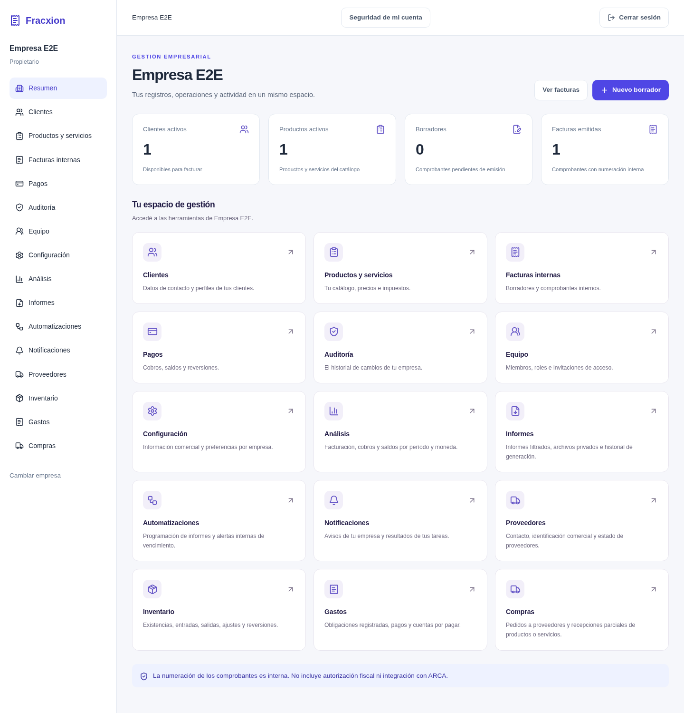

# Fracxion

Aplicación web de gestión comercial para negocios que llevan una o varias empresas: clientes, catálogo, facturas internas, cobros, compras, gastos e inventario, con datos separados por empresa y permisos por rol.

[](https://github.com/nelsonvis3/fracxion-facturador/actions/workflows/ci.yml)

Demo en preparación · [Caso de estudio](https://nelsonvis-portfolio.vercel.app/proyectos/ledgercore/)



> **English summary:** Fracxion is a multi-company business app built with Django REST Framework, Next.js and PostgreSQL. It covers customers, a product catalog, internal (non-fiscal) invoices, payments with reversals, purchases, expenses and inventory. Each company's data is isolated on the server and every user works with the role of their membership.

## Qué hace

- Una cuenta puede pertenecer a varias empresas, con un rol distinto en cada una (`owner`, `admin`, `accountant`, `sales`, `viewer`). Hay registro, verificación de correo, recuperación de contraseña, MFA opcional con TOTP e invitaciones al equipo.
- Clientes y productos o servicios con SKU, moneda, precio e impuesto. Se desactivan en lugar de borrarse, para no romper documentos viejos.
- Facturas internas de hasta 100 líneas. El servidor calcula los importes, asigna un número correlativo por empresa al emitir y la factura se imprime desde el navegador.
- Cobros parciales o totales y reversiones con motivo. El pago original queda en el historial.
- Compras a proveedores: borrador, confirmación, recepción que suma stock y cierre. El inventario se mueve solo con movimientos registrados, no admite stock negativo y avisa al llegar al mínimo.
- Gastos con categoría, comprobante adjunto, pagos y anulación.
- Tablero con lo facturado, cobrado, pendiente y vencido por período; informes en CSV, Excel o PDF; reglas que generan alertas internas de vencimiento e informes programados, ejecutadas por un worker aparte.

Un ejemplo con los números que usan los tests: un servicio de ARS 100 con 21% de impuesto genera una factura de ARS 121. Un cobro de ARS 40 deja un saldo de ARS 81. Si ese cobro se revierte, el saldo vuelve a ARS 121 y los dos movimientos quedan registrados ([captura de esa factura](docs/screenshots/invoice.png)).

## Stack

| Parte | Tecnologías |
| --- | --- |
| Backend | Python 3.14, Django 5.2, Django REST Framework, PostgreSQL 17 |
| Frontend | Next.js 16, React 19, TypeScript, Tailwind CSS 4 |
| Infraestructura | Docker Compose con Gunicorn, Redis, Caddy y un worker de tareas |
| Pruebas | Django TestCase, Coverage, Ruff, ESLint, Playwright y GitHub Actions |

El backend está dividido por dominio en [`backend/`](backend): `accounts` (cuentas, sesiones, MFA), `tenancy` (empresas, membresías, permisos), `customers`, `catalog`, `billing` (facturas y cobros), `operations` (proveedores, inventario, compras y gastos), `analytics`, `reports`, `automation` (reglas, tareas y notificaciones) y `auditlog`.

## Decisiones técnicas

### Datos separados por empresa

Todas las empresas comparten tablas, así que un error en un filtro podría mostrar datos de otra. La empresa sale del `tenant_id` de la URL y [`TenantAccessPermission`](backend/tenancy/permissions.py) comprueba que el usuario, la membresía y la empresa estén activos y que el rol permita la acción. Los [mixins de tenancy](backend/tenancy/mixins.py) filtran cada consulta con ese contexto, y al crear una factura el cliente y los productos también tienen que ser de la misma empresa: un UUID válido de otra empresa devuelve 404.

### Importes calculados en el servidor

Si el navegador mandara precios, cualquiera podría cambiarlos. El cliente envía producto y cantidad; [`billing/services.py`](backend/billing/services.py) toma precio e impuesto del catálogo y calcula con `Decimal`, redondeando a centavos con `ROUND_HALF_UP`. La API devuelve los importes como texto para no perder decimales.

### Operaciones simultáneas

Dos emisiones al mismo tiempo podrían recibir el mismo número, y dos cobros simultáneos podrían pasar el saldo. Emitir y cobrar corren dentro de `transaction.atomic()` con `select_for_update()` sobre la empresa y la factura, y PostgreSQL tiene una restricción única para el número dentro de cada empresa. Bloquear por empresa serializa esas escrituras; a cambio, la regla es fácil de seguir. Los tests de concurrencia usan conexiones separadas contra PostgreSQL.

### Corregir con otro movimiento, nunca editando

Una factura emitida o un pago no se editan ni se borran: un error se corrige con una reversión. El stock funciona igual, como una lista de movimientos con clave de idempotencia y una restricción que impide saldo negativo ([`operations/models.py`](backend/operations/models.py)). Cada operación y su evento de auditoría se guardan en la misma transacción, así que si falla la auditoría tampoco se guarda la operación.

## Cómo correrlo

Necesitás Python 3.14, Node.js 22 y PostgreSQL. Crear la base:

```bash
createuser --pwprompt facturador
createdb --owner=facturador facturador
```

Backend, desde la raíz del repositorio (la contraseña de `createuser` va en `DB_PASSWORD` de `backend/.env`):

```bash
cd backend
python3.14 -m venv .venv
.venv/bin/python -m pip install -r requirements-dev.txt
cp .env.example .env
.venv/bin/python manage.py migrate
.venv/bin/python manage.py runserver localhost:8000
```

Frontend, en otra terminal:

```bash
cd frontend
cp .env.example .env.local
npm ci
npm run dev
```

Abrir http://localhost:3000 y elegir **Crear cuenta**: el registro crea la empresa y te deja como propietario. Las variables, los comandos de administración y los problemas comunes están en [docs/DESARROLLO.md](docs/DESARROLLO.md). La instalación con Docker Compose para un servidor está en [docs/OPERATIONS.md](docs/OPERATIONS.md) y la API en [docs/API.md](docs/API.md).

## Tests

El backend necesita un PostgreSQL donde el usuario pueda crear la base de pruebas. Desde `backend/`:

```bash
.venv/bin/coverage run manage.py test --settings=config.test_settings --noinput
.venv/bin/coverage report --fail-under=85
```

Desde `frontend/`:

```bash
npm run lint
npm run typecheck
npm run test:e2e
```

Son 367 tests de backend con 92% de cobertura y 53 escenarios de Playwright en 18 archivos, medidos el 16 de octubre de 2026. Cubren permisos y aislamiento entre empresas, cálculo de importes, numeración y cobros concurrentes, registro, recuperación, MFA, compras, gastos, inventario, informes y el recorrido completo en el navegador. Los E2E necesitan una base y una API de prueba aparte: los pasos están en [docs/TESTING.md](docs/TESTING.md). GitHub Actions corre todo esto en cada push.

## Estado

Todo lo de "Qué hace" funciona en local y pasa en CI. No hay demo pública todavía: el despliegue en una VM de Oracle Cloud está preparado en [docs/ORACLE_DEPLOYMENT.md](docs/ORACLE_DEPLOYMENT.md), pero falta validar dominio, correo y backups.

Las facturas son de gestión interna: no se conectan con ARCA ni obtienen CAE. Las notas de crédito y débito existen en el modelo, pero todavía no se pueden emitir. Tampoco hay conciliación bancaria, planes de suscripción ni pruebas de carga.

## Qué aprendí

<!-- Nelson: respondé con tus palabras, 3-5 líneas:
- ¿Qué fue lo que más te costó y cómo lo resolviste?
- ¿Qué harías distinto si lo empezaras hoy?
- ¿Qué parte te gustaría explicar en una entrevista? -->

## Licencia

Todavía no tiene licencia.
