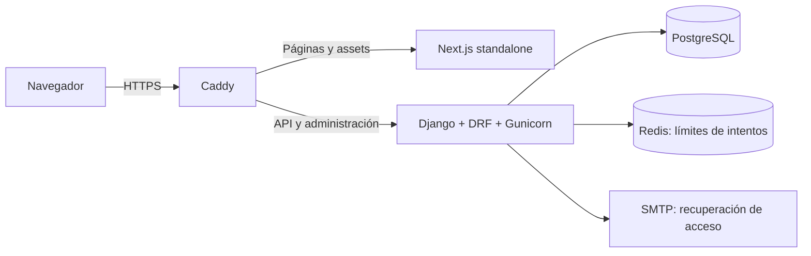

# Fracxion

Sistema de gestión empresarial para organizar clientes, catálogo, facturas internas y cobros de varias empresas desde una misma aplicación.

Fracxion conecta el recorrido comercial completo: dar de alta un cliente, preparar un documento con los precios del catálogo, emitirlo, registrar sus cobros y consultar qué ocurrió en cada operación. Cada empresa tiene sus propios datos y cada usuario trabaja con los permisos de su membresía.

El backend está construido con Django y Django REST Framework; el frontend, con Next.js, React y TypeScript. PostgreSQL conserva los datos comerciales, las sesiones y las restricciones que acompañan a las reglas de negocio.

**Los comprobantes son de gestión interna.** La aplicación no emite documentos autorizados por ARCA ni gestiona CAE. El alcance implementado está explicado al final de este documento.


Captura del sistema en ejecución con cuentas y operaciones sintéticas. Más vistas: [dashboard móvil](docs/screenshots/dashboard-mobile.png), [resumen de empresa](docs/screenshots/company-dashboard-desktop.png), [resumen móvil](docs/screenshots/company-dashboard-mobile.png) y [detalle de factura](docs/screenshots/invoice.png).

## Contenido

- [Qué permite hacer](#qué-permite-hacer)
- [Un recorrido por el sistema](#un-recorrido-por-el-sistema)
- [Arquitectura y decisiones técnicas](#arquitectura-y-decisiones-técnicas)
- [Usuarios, empresas y permisos](#usuarios-empresas-y-permisos)
- [Desarrollo local](#desarrollo-local)
- [Contrato de la API](#contrato-de-la-api)
- [Pruebas y estado de la verificación](#pruebas-y-estado-de-la-verificación)
- [Despliegue y operación](#despliegue-y-operación)
- [Alcance actual y siguientes pasos](#alcance-actual-y-siguientes-pasos)
- [Documentación del repositorio](#documentación-del-repositorio)

## Qué permite hacer

El trabajo se organiza por empresa. Después de iniciar sesión, el usuario ve los espacios a los que pertenece y puede entrar al resumen de cada uno. Desde allí accede a sus módulos y a los contadores de clientes, catálogo, facturas y pagos.

| Área | Funciones disponibles |
| --- | --- |
| Acceso | Registro de cuenta con empresa propia, login por correo, selección de empresa, recuperación de contraseña y cierre de sesión. |
| Clientes | Alta, edición, búsqueda, filtros, paginación, desactivación y reactivación. Incluye datos de contacto, identificación y domicilio. |
| Productos y servicios | Catálogo con SKU, unidad, moneda, precio e impuesto. Los registros se pueden editar o desactivar conservando sus referencias. |
| Facturas internas | Creación de borradores de hasta 100 líneas, cálculo de importes en el servidor, emisión con numeración por empresa, consulta e impresión desde el navegador. |
| Cobros | Pagos parciales o totales, método, referencia, saldo pendiente y reversión con motivo. El pago original permanece en el historial. |
| Auditoría | Consulta de acciones, entidades, actor, fecha, cambios y metadatos. Disponible para propietarios y administradores de la empresa. |
| Administración de plataforma | Django Admin para usuarios, empresas y membresías. Los registros comerciales se consultan en modo lectura. |

Los formularios utilizan los países y provincias/estados publicados por la API de referencia. La validación comprueba formato y coherencia de documentos, teléfonos y domicilios; no verifica la identidad de una persona ni la existencia de una dirección.

La interfaz adapta su navegación a escritorio y móvil. Los estados de carga, error, reintento y lista vacía forman parte del flujo: por ejemplo, el módulo de pagos explica por qué no hay facturas disponibles y permite buscar entre los documentos emitidos con saldo.

### Acceso y transiciones

La entrada al login utiliza una composición de Hyperframes: la F despliega `racxion`, recupera las letras y se desplaza al logo antes de revelar el formulario. Durante la secuencia, el scroll permanece oculto; se habilita cuando el login queda disponible.

Un acceso confirmado muestra la bienvenida con el nombre del usuario o, si falta, el de una empresa a la que tiene acceso. La F gira mientras termina de cargar el dashboard y la pantalla aparece con un fundido. Al salir, primero se confirma el logout en Django, se retiran las vistas privadas y se muestra la despedida; después se reproduce la introducción completa del login.

Las animaciones se pueden omitir y respetan movimiento reducido. La introducción se repite al recargar el login, pero no en una navegación interna del mismo documento después de completarla. Los recursos visuales se sirven desde la aplicación. El detalle de reproducción, fallbacks, accesibilidad y pruebas está en [LOGIN_INTRO.md](docs/LOGIN_INTRO.md).

## Un recorrido por el sistema

Este es el flujo que puede probarse desde la interfaz con una cuenta propietaria:

1. **Crear la cuenta y la empresa.** El registro abre la sesión y asigna al usuario como propietario del nuevo espacio.
2. **Dar de alta un cliente.** Sus datos quedan vinculados a esa empresa.
3. **Agregar un producto o servicio.** Por ejemplo, un servicio de ARS 100,00 con un impuesto del 21%.
4. **Guardar una factura interna en borrador.** Con una unidad del servicio, el servidor calcula un subtotal de ARS 100,00, impuesto de ARS 21,00 y total de ARS 121,00.
5. **Emitir el documento.** Se verifica su consistencia y se le asigna un número interno único dentro de la empresa.
6. **Registrar un cobro.** Un pago de ARS 40,00 deja un saldo de ARS 81,00. El selector de pagos ofrece facturas emitidas con saldo; los borradores quedan fuera de ese flujo.
7. **Consultar el historial.** El detalle muestra los cobros y el saldo. Si el pago fue incorrecto, una reversión con motivo conserva el registro original y devuelve el saldo a ARS 121,00.

Este recorrido también está cubierto por pruebas de navegador que contrastan los resultados con la API y vuelven a consultar los datos después de las escrituras.

## Arquitectura y decisiones técnicas

El repositorio contiene un backend organizado por dominios y un frontend que consume su API. La lógica comercial está en los servicios de Django: la interfaz envía la intención del usuario y presenta la respuesta del servidor.



El diagrama representa la configuración de producción incluida en el repositorio. En desarrollo, Next.js y Django se ejecutan en puertos distintos; Django puede usar caché local y correo de consola. En producción, Caddy expone un único dominio y dirige `/api/`, `/admin/`, `/static/`, `/health/` y `/ready/` al backend. Las páginas y los recursos de Next.js van al frontend.

| Capa | Tecnología | Responsabilidad |
| --- | --- | --- |
| Backend | Python 3.14, Django 5.2.18, DRF 3.18.1 | Autenticación, permisos, validación, operaciones comerciales y administración. |
| Persistencia | PostgreSQL, psycopg 3 | Datos, sesiones, restricciones de unicidad, transacciones y bloqueos de filas. Compose y CI configuran PostgreSQL 17. |
| Frontend | Next.js 16.4.0, React 19.3.0, TypeScript, Tailwind CSS 4 | Navegación, formularios, estados de interfaz y presentación de respuestas de la API. |
| Animación | Hyperframes 0.8.155 y GSAP 3.15.0 | Introducción de marca y transiciones de sesión con recursos locales. |
| Infraestructura | Gunicorn, WhiteNoise, Redis 8 y Caddy 2 | Servidor Django, estáticos, límites compartidos y proxy HTTPS. |
| Calidad | Django TestCase/TransactionTestCase, Coverage, Ruff, ESLint, TypeScript y Playwright | Regresiones del dominio, concurrencia, comprobaciones estáticas y flujos de navegador. |

Las dependencias Python están fijadas en [requirements.txt](backend/requirements.txt), con las herramientas de desarrollo en [requirements-dev.txt](backend/requirements-dev.txt). El frontend conserva su resolución en `package-lock.json` y se instala con `npm ci`. Los Dockerfiles y CI utilizan Node.js 22.

### Aislamiento por empresa

Las empresas comparten la base de datos y las tablas del dominio. La separación se implementa con la relación `tenant`, los permisos y los filtros del servidor.

La empresa de una petición se obtiene del `tenant_id` de la ruta. [TenantAccessPermission](backend/tenancy/permissions.py) comprueba que el usuario, la membresía y la empresa estén activos y que el rol permita la operación. El contexto autorizado se utiliza para limitar el queryset y asignar la empresa durante las escrituras.

El aislamiento también se aplica a las relaciones: al crear una factura, el cliente y cada producto deben pertenecer a la misma empresa. Un UUID válido de otro espacio no alcanza para leer un objeto ni vincularlo a un documento.

Esta política se comparte entre módulos mediante [los mixins de tenancy](backend/tenancy/mixins.py). Los servicios comerciales vuelven a comprobar el contexto y los permisos dentro de sus transacciones.

### Importes calculados en el backend

El cliente envía producto y cantidad. El servidor obtiene el precio y el impuesto del catálogo autorizado y calcula los totales con `Decimal`.

El precio de línea conserva cuatro decimales y la cantidad admite tres. El subtotal se redondea a centavos con `ROUND_HALF_UP`; después se calcula y redondea el impuesto sobre ese subtotal. El total del documento suma los importes de sus líneas. Los importes de la API se devuelven como cadenas para conservar su representación decimal.

El frontend formatea los valores recibidos. Las reglas de cálculo y los controles de saldo viven en [billing/services.py](backend/billing/services.py), junto con los servicios de creación, emisión, cobro y reversión.

### Operaciones simultáneas

Emitir una factura o registrar un cobro requiere comprobar datos que pueden cambiar mientras otra petición está en curso. Por eso estas operaciones se ejecutan dentro de `transaction.atomic()` y utilizan `select_for_update()`.

La emisión bloquea la empresa para serializar su numeración, bloquea el documento y comprueba las líneas antes de emitirlo. PostgreSQL agrega una restricción de unicidad para el número dentro de cada empresa. El registro de pagos bloquea la empresa y la factura y vuelve a calcular el saldo antes de aceptar el importe.

Así se evita que dos solicitudes de emisión asignen el mismo número o que dos cobros simultáneos se aprueben contra un saldo desactualizado. Las pruebas de concurrencia utilizan conexiones independientes contra PostgreSQL.

El bloqueo por empresa simplifica la consistencia de estas operaciones, a costa de serializar esas escrituras dentro del mismo espacio. Un cambio de estrategia necesita mediciones de carga y debe conservar las regresiones de numeración y saldo.

### Historia del documento y auditoría

Al crear un borrador se guardan copias de los datos del cliente, las descripciones, los precios y los impuestos. Estas copias —los snapshots— explican qué se usó para calcular el documento aunque luego cambie el catálogo o se edite el cliente.

Las API no ofrecen edición ni eliminación de facturas emitidas o pagos. Una reversión crea un registro separado. Las referencias externas de pago son únicas por empresa y método, incluso si el pago fue revertido.

La operación comercial y su evento de auditoría se guardan en la misma transacción: si falla el registro de auditoría, la escritura también se revierte. La auditoría evita copiar notas y descripciones libres, pero conserva datos estructurados de la operación; por eso su consulta tiene permisos propios.

### Sesión y protección de escrituras

La autenticación utiliza las sesiones de Django y cookies HttpOnly. El navegador obtiene el token CSRF enmascarado por JSON y lo envía en `X-CSRFToken` junto con las cookies al realizar una escritura. [El cliente HTTP](frontend/src/lib/api.ts) obtiene el token antes de cada mutación para respetar su rotación.

Las respuestas de la API llevan `Cache-Control: private, no-store`. El logout y una sesión inválida en una ruta privada provocan una navegación que descarta el documento del navegador, incluidos los datos que el router pudiera conservar en vistas ocultas.

Login, registro y recuperación tienen límites de intentos. La recuperación responde de forma genérica; su enlace vence en una hora y deja de ser válido después del cambio de contraseña. En producción, Redis comparte los límites entre workers y la aplicación exige HTTPS, cookies Secure y una configuración explícita de proxy de confianza.

### Dónde está cada responsabilidad

```text
backend/
  accounts/        Usuarios, registro, sesiones y recuperación de acceso
  tenancy/         Empresas, membresías, permisos y contexto autorizado
  customers/       Clientes, validaciones y cambios de estado
  catalog/         Productos y servicios
  billing/         Facturas, líneas, pagos, reversiones y servicios del dominio
  auditlog/        Historial de operaciones
  config/          Configuración, rutas, referencia, middleware y salud
frontend/
  src/app/         Login, registro, recuperación y módulos por empresa
  src/components/ Navegación, formularios y transiciones compartidas
  src/lib/         Cliente HTTP, contratos TypeScript y acceso a la API
  public/          Recursos locales y composición Hyperframes
  scripts/         Preparación de assets y salida standalone
  e2e/             Escenarios Playwright
deploy/            Configuración de Caddy
docs/              Operación, pruebas, auditoría y capturas
.github/workflows/ CI de backend y frontend/E2E
```

## Usuarios, empresas y permisos

Una cuenta puede pertenecer a varias empresas y tener un rol distinto en cada una. Los permisos comerciales se determinan por la membresía del espacio al que se está accediendo.

| Operación | `owner` | `admin` | `accountant` | `sales` | `viewer` |
| --- | :---: | :---: | :---: | :---: | :---: |
| Consultar clientes, catálogo, facturas y pagos | Sí | Sí | Sí | Sí | Sí |
| Crear o editar clientes y catálogo | Sí | Sí | — | — | — |
| Crear borradores y emitir facturas internas | Sí | Sí | — | — | — |
| Registrar pagos | Sí | Sí | Sí | — | — |
| Revertir pagos | Sí | Sí | — | — | — |
| Consultar auditoría | Sí | Sí | — | — | — |

El rol `sales` está definido en el dominio y actualmente tiene acceso de consulta a estos módulos. La tabla describe los permisos implementados, incluidos los controles del backend; ocultar un botón en la interfaz no concede ni revoca autorización.

El registro público crea una cuenta normal, una empresa nueva y una membresía `owner`. No permite elegir privilegios ni incorporarse a una empresa existente. Cuenta, empresa, membresía y evento de auditoría se guardan juntos. Los errores se devuelven por campo y el correo se valida por formato; todavía no hay un paso de verificación por enlace.

La administración de plataforma se realiza por separado en Django Admin. Ser propietario de una empresa no habilita ese panel. Del mismo modo, un superusuario de plataforma necesita una membresía activa para utilizar las API de esa empresa.

## Desarrollo local

Los comandos siguientes usan una shell de Linux/macOS. Se necesita Python 3.14, Node.js 22 con npm y PostgreSQL en ejecución. Redis y SMTP externo se requieren para la configuración de producción; en desarrollo se puede utilizar caché local y correo de consola.

```bash
git clone https://github.com/nelsonvis3/fracxion-facturador.git
cd fracxion-facturador
```

### 1. Preparar PostgreSQL

Si ya hay una base de desarrollo, se pueden usar sus datos de conexión en `backend/.env`. Para crear una nueva, ejecutar lo siguiente desde una cuenta de PostgreSQL con permiso para crear roles y bases:

```bash
createuser --pwprompt facturador
createdb --owner=facturador facturador
```

La contraseña que solicita `createuser` debe coincidir con `DB_PASSWORD` en la configuración del backend. Estos comandos crean el usuario y la base; las tablas se crean con las migraciones de Django.

### 2. Instalar y configurar el backend

Desde la raíz del repositorio:

```bash
cd backend
python3.14 -m venv .venv
.venv/bin/python -m pip install -r requirements-dev.txt
test -f .env || cp .env.example .env
```

Editar `backend/.env` con la conexión local y una clave propia. El archivo de ejemplo contiene valores de desarrollo. Si el entorno ya existe, conservarlo y ajustar únicamente las variables necesarias.

| Variables | Uso |
| --- | --- |
| `DB_NAME`, `DB_USER`, `DB_PASSWORD`, `DB_HOST`, `DB_PORT`, `DB_SSLMODE` | Conexión a PostgreSQL. El ejemplo usa `facturador`, `127.0.0.1` y puerto `5432`. |
| `DJANGO_ENV`, `DJANGO_DEBUG`, `DJANGO_SECRET_KEY`, `DJANGO_ALLOWED_HOSTS` | Entorno, depuración, clave de Django y hosts aceptados. |
| `CORS_ALLOWED_ORIGINS`, `CSRF_TRUSTED_ORIGINS` | Orígenes explícitos desde los que accede el frontend. |
| `FRONTEND_PASSWORD_RESET_URL` | Dirección del formulario de recuperación; en desarrollo, `http://localhost:3000/reset-password`. |
| `DJANGO_EMAIL_BACKEND`, `DEFAULT_FROM_EMAIL` | Backend de correo y remitente. El ejemplo imprime los enlaces en la consola. |
| `REDIS_URL` | Caché compartida para los límites de intentos; opcional en desarrollo y obligatoria en producción. |

Aplicar migraciones e iniciar Django desde `backend/`:

```bash
.venv/bin/python manage.py migrate
.venv/bin/python manage.py runserver localhost:8000
```

### 3. Instalar e iniciar el frontend

En otra terminal, desde la raíz:

```bash
cd frontend
test -f .env.local || cp .env.example .env.local
npm ci
npm run dev
```

Abrir `http://localhost:3000`. El ejemplo de `frontend/.env.local` apunta la API a `http://localhost:8000` mediante `NEXT_PUBLIC_API_BASE_URL`.

Usar el mismo hostname en ambos servicios. Mezclar `localhost` y `127.0.0.1` puede dejar las cookies en un host distinto del que utiliza la aplicación.

### 4. Crear el primer espacio de trabajo

Desde el login, elegir **Crear cuenta**, completar los datos de cuenta y empresa y confirmar la contraseña. El sistema crea el espacio, asigna la membresía propietaria y abre su resumen.

Para un alta administrativa también está disponible este comando, ejecutado desde `backend/`:

```bash
.venv/bin/python manage.py create_workspace \
  --email propietario@example.com \
  --name "Mi empresa" \
  --slug mi-empresa
```

Solicita la contraseña de forma privada al crear una cuenta y puede vincular una cuenta activa existente. No convierte al propietario en superusuario. Para administrar cuentas y membresías desde `http://localhost:8000/admin/`, crear por separado una cuenta de plataforma:

```bash
.venv/bin/python manage.py createsuperuser
```

### Build local

Desde `frontend/`:

```bash
npm run build -- --webpack
env PORT=3000 HOSTNAME=localhost npm run start
```

Este es el modo de build utilizado en las últimas verificaciones locales. `npm run build` utiliza el motor predeterminado de Next.js; los Dockerfiles y CI conservan ese comando.

`prebuild` prepara los recursos locales de Hyperframes y `postbuild` copia los recursos públicos y los chunks al directorio standalone. `NEXT_PUBLIC_API_BASE_URL` se incorpora al compilar: cambiar esa variable requiere reconstruir el frontend. El build Docker la deja vacía para consultar `/api/` bajo el mismo dominio.

### Si el entorno no arranca

| Síntoma | Qué revisar |
| --- | --- |
| Django no conecta a la base | PostgreSQL en ejecución, nombre de base, usuario, contraseña y puerto de `backend/.env`. |
| La sesión no se conserva o aparece un error CSRF | Hostnames consistentes, cookies y orígenes permitidos. El cliente debe enviar credenciales y obtener un token CSRF antes de escribir. |
| Los enlaces de recuperación no llegan a un buzón local | El backend de desarrollo imprime el mensaje en la terminal de Django. |
| El frontend consulta una API anterior | Reconstruir después de cambiar `NEXT_PUBLIC_API_BASE_URL`. |
| Producción no inicia por migraciones pendientes | Ejecutar las migraciones como paso de release antes de arrancar Gunicorn. |

## Contrato de la API

Las rutas llevan `/` final. Los recursos comerciales utilizan UUID y se encuentran bajo `/api/tenants/{tenant_id}/`. Las listas comerciales se paginan en bloques de 25 y devuelven `count`, `next`, `previous` y `results`.

### Autenticación y referencia

| Método | Ruta | Función |
| --- | --- | --- |
| GET | `/api/auth/csrf/` | Obtener `csrfToken` y la cookie correspondiente. |
| POST | `/api/auth/register/` | Crear cuenta y empresa; requiere CSRF. |
| POST | `/api/auth/login/` | Abrir sesión con `email` y `password`; requiere CSRF. |
| POST | `/api/auth/logout/` | Cerrar la sesión; requiere CSRF. |
| GET | `/api/auth/me/` | Consultar la cuenta autenticada. |
| GET | `/api/auth/tenants/` | Consultar sus empresas y roles. |
| POST | `/api/auth/password-reset/` | Solicitar recuperación con `email`. |
| POST | `/api/auth/password-reset/confirm/` | Cambiar la contraseña con `uid`, `token`, `password` y `password_confirm`. |
| GET | `/api/reference/countries/` | Consultar países; requiere sesión. |
| GET | `/api/reference/countries/{code}/subdivisions/` | Consultar provincias/estados; requiere sesión. |

El registro recibe `first_name`, `last_name` opcional, `company_name`, `email`, `password` y `password_confirm`. Responde `201` con `user`, `tenant` y un `csrfToken` renovado. Una cuenta autenticada debe cerrar su sesión antes de registrar otra.

### Operaciones por empresa

El prefijo de todas las rutas de esta tabla es `/api/tenants/{tenant_id}/`.

| Método | Recurso | Función |
| --- | --- | --- |
| GET, POST | `customers/` | Listar o crear clientes. |
| GET, PUT, PATCH | `customers/{id}/` | Consultar o actualizar un cliente. |
| POST | `customers/{id}/deactivate/` | Desactivar sin eliminar. |
| GET, POST | `products/` | Listar o crear productos y servicios. |
| GET, PUT, PATCH | `products/{id}/` | Consultar o actualizar un registro del catálogo. |
| POST | `products/{id}/deactivate/` | Desactivar sin eliminar. |
| GET, POST | `invoices/` | Listar documentos o crear un borrador. |
| GET | `invoices/{id}/` | Consultar líneas, importes, cobros y saldo. |
| POST | `invoices/{id}/issue/` | Emitir un borrador. |
| GET, POST | `payments/` | Consultar o registrar pagos. |
| GET | `payments/{id}/` | Consultar un pago y su reversión. |
| POST | `payments/{id}/reverse/` | Revertir con un `reason`. |
| GET | `audit-events/` | Consultar el historial autorizado. |

Clientes y productos se reactivan mediante PATCH con `{"is_active": true}`. Búsqueda, filtros y ordenamiento están definidos en las vistas de cada módulo.

Un borrador se crea con un cuerpo de esta forma; los identificadores se obtienen de los clientes y productos de la empresa autorizada:

```json
{
  "customer": "00000000-0000-4000-8000-000000000010",
  "currency": "ARS",
  "lines": [
    {
      "product": "00000000-0000-4000-8000-000000000020",
      "quantity": "2.500"
    }
  ],
  "notes": "Condiciones comerciales"
}
```

No se envían precios ni totales. Todos los productos deben compartir la moneda del documento. Para un cobro sobre una factura emitida, el cuerpo es:

```json
{
  "invoice": "00000000-0000-4000-8000-000000000030",
  "method": "bank_transfer",
  "amount": "40.00",
  "external_reference": "TRANSFERENCIA-DE-EJEMPLO"
}
```

Los UUID de los ejemplos son ilustrativos y deben sustituirse por registros existentes. Los métodos disponibles son `cash`, `bank_transfer`, `debit_card`, `credit_card`, `digital_wallet`, `check` y `other`.

Las escrituras deben conservar las cookies y enviar `X-CSRFToken`. Una sesión ausente produce `401`; un rol insuficiente, `403`; un objeto ajeno dentro de una empresa autorizada, `404`. Los errores de validación producen `400` y los límites de intentos, `429`.

OpenAPI está disponible con sesión en `http://localhost:8000/api/docs/` y `/api/schema/`. Describe los recursos expuestos por DRF; las vistas Django de registro, login, logout y recuperación se documentan también en la tabla anterior.

## Pruebas y estado de la verificación

Las últimas verificaciones locales disponibles al **14 de octubre de 2026** son:

| Comprobación | Evidencia |
| --- | --- |
| Backend | 216 pruebas aprobadas sobre PostgreSQL temporal, incluidas regresiones de permisos, registro, importes y concurrencia. |
| Cobertura backend | 91% de sentencias; umbral configurado de 85%. Excluye tests, migraciones, configuración E2E y entrypoints. |
| E2E | 35 escenarios aprobados en una ejecución conjunta, sin reintentos ni omisiones. |
| Frontend | ESLint, TypeScript, build Webpack y preparación de standalone aprobados. |
| Navegador | Flujos comerciales, roles, aislamiento, recuperación, registro, historial después del logout, escritorio/móvil y estados de error/reintento. |
| Introducción y sesión | Secuencia, recarga, omisión, movimiento reducido, fallos de recursos, bienvenida, despedida, carga lenta y entrega del dashboard. |
| Viewport | Sin scrollbar ni franjas durante la introducción, incluso antes de ejecutar JavaScript; scroll operativo después, con barras nativas visibles. |

Son resultados de ejecuciones locales anteriores a esta actualización del README. La última corrección visual repitió la suite E2E y los checks frontend; los tests backend corresponden a la revisión de las transiciones. PostgreSQL 18.6 se utilizó en esas pruebas locales; Compose y CI configuran la versión 17.

La evidencia y los procedimientos están en [TESTING.md](docs/TESTING.md), [LOGIN_INTRO.md](docs/LOGIN_INTRO.md) y [AUDIT_LOG.md](docs/AUDIT_LOG.md). Las pruebas de navegador trabajan sobre `test_facturador_e2e` y cuentas sintéticas. El script de preparación exige configuración de pruebas y un nombre de base con prefijo `test_`.

### Ejecutar los checks

Los checks del backend se ejecutan desde `backend/`. Para los tests, configurar
la conexión a PostgreSQL aislado según [TESTING.md](docs/TESTING.md): Django crea
y elimina su base de pruebas, por lo que el usuario utilizado necesita permiso
para crearla. La cuenta de desarrollo del ejemplo anterior no recibe ese permiso
automáticamente.

```bash
.venv/bin/ruff check .
.venv/bin/ruff format --check .
.venv/bin/python manage.py check
.venv/bin/python manage.py makemigrations --check --dry-run
.venv/bin/python manage.py spectacular --validate --fail-on-warn --file /tmp/fracxion-schema.yaml
.venv/bin/coverage run manage.py test --settings=config.test_settings --noinput
.venv/bin/coverage report --fail-under=85
```

Desde `frontend/`:

```bash
npm run lint
npm run typecheck
npm run build -- --webpack
```

E2E necesita la API de pruebas en `127.0.0.1:8001` y el frontend compilado con esa URL en `127.0.0.1:3010`. Con ambos preparados según [la guía de pruebas](docs/TESTING.md):

```bash
npm run test:e2e
```

Una base separada y PostgreSQL real son parte de esta verificación: SQLite no reproduce los bloqueos de filas utilizados por el dominio. La configuración de tests simplifica el hashing de contraseñas, el correo y el caché exclusivamente para las pruebas.

### CI y dependencias

[GitHub Actions](.github/workflows/ci.yml) configura dos jobs: backend y frontend/E2E. Incluye PostgreSQL 17, Ruff, validación de migraciones y OpenAPI, cobertura, build, auditorías de dependencias y Playwright. El workflow está incluido; una ejecución local aprobada no informa por sí sola el estado de CI remoto.

La revisión del 15 de octubre de 2026 registró cero vulnerabilidades conocidas en npm audit completo y pip-audit. La cadena de desarrollo ESLint/braces se sustituyó de forma acotada, conservando reglas oficiales y pruebas de su funcionamiento. Ver [ORACLE_DEPLOYMENT_TESTING.md](docs/ORACLE_DEPLOYMENT_TESTING.md). Los audits deben repetirse: no garantizan ausencia de vulnerabilidades futuras.

## Despliegue y operación

La referencia de instalación está en [compose.yaml](compose.yaml), los Dockerfiles y [deploy/Caddyfile](deploy/Caddyfile). Incluye PostgreSQL, Redis, Django/Gunicorn, Next.js standalone y Caddy. Solo el proxy publica puertos.

La configuración de Compose usa el `.env` de la raíz, a partir de [.env.example](.env.example). Es un archivo distinto de `backend/.env` y `frontend/.env.local`. Debe completarse con el dominio, claves propias, contraseña de PostgreSQL y credenciales SMTP del entorno de destino.

Con esa configuración lista, la secuencia de una instalación nueva es:

```bash
docker compose build
docker compose up -d database cache
docker compose run --rm backend python manage.py migrate --noinput
docker compose run --rm backend python manage.py check --deploy --fail-level WARNING
docker compose up -d
```

Las migraciones se aplican como paso explícito. `backend/start.sh` comprueba que no haya migraciones pendientes, recolecta estáticos y arranca Gunicorn. La aplicación rechaza configuraciones de producción con DEBUG, claves de ejemplo, hosts ausentes, cookies inseguras o sin la configuración requerida de Redis, SMTP y proxy.

| Endpoint | Qué comprueba |
| --- | --- |
| `/health/` | Que el proceso Django responda. |
| `/ready/` | Conectividad con PostgreSQL y escritura/lectura de caché. Devuelve `503` si una dependencia falla. |

La [guía de operación](docs/OPERATIONS.md) desarrolla HTTPS, proxies de confianza, recuperación por correo, backups con `pg_dump`, restauración en una base separada y actualizaciones. También conviene revisar la [lista de despliegue de Django 5.2](https://docs.djangoproject.com/en/5.2/howto/deployment/checklist/) para la infraestructura elegida.

El volumen de PostgreSQL mantiene los datos entre reinicios, pero las copias externas y la comprobación de restauración siguen siendo parte de la operación. La entrega de correo, el dominio público, los certificados y el comportamiento bajo carga se validan en el entorno final. Este README documenta una configuración de despliegue; no acredita una instalación pública ni un SLA.

## Alcance actual y siguientes pasos

La versión actual cubre gestión comercial por empresa: clientes, productos y servicios, documentos internos, cobros y trazabilidad. Esa es la funcionalidad que se describe y se prueba en este repositorio.

Hay áreas que requieren desarrollo propio antes de formar parte del producto:

- Facturación fiscal con ARCA y gestión de CAE.
- Notas de crédito y débito con sus reglas y referencias documentales. El modelo contempla los tipos, pero el servicio de emisión acepta facturas internas.
- Inventario, compras, proveedores y movimientos de stock.
- Conciliación bancaria, procesamiento de pagos y generación de PDF en el servidor; hoy se registran cobros y se utiliza impresión del navegador.
- Invitaciones de miembros, administración de equipos desde la interfaz y verificación de correo por enlace.
- Planes, suscripciones y cobro por el uso de la plataforma.

La base de aplicación permite trabajar con varias empresas, pero esos módulos necesitan contratos, permisos, migraciones y pruebas propios. Para extender el proyecto, las escrituras comerciales deben pasar por los servicios del backend y conservar el contexto de empresa, la precisión decimal y la auditoría transaccional.

La preparación de producción también requiere completar pruebas de carga, SMTP real, backups externos y aceptación con usuarios del negocio. Los resultados locales sirven como evidencia técnica del comportamiento probado.

## Documentación del repositorio

| Documento | Contenido |
| --- | --- |
| [TESTING.md](docs/TESTING.md) | PostgreSQL aislado, configuración de tests, preparación E2E y comandos reproducibles. |
| [OPERATIONS.md](docs/OPERATIONS.md) | Instalación de producción, HTTPS, SMTP, backups, restauración y mantenimiento. |
| [LOGIN_INTRO.md](docs/LOGIN_INTRO.md) | Introducción, transiciones, comportamiento del scroll, accesibilidad, capturas y verificación. |
| [AUDIT.md](docs/AUDIT.md) | Revisión técnica y alcance de las comprobaciones de esa etapa. |
| [AUDIT_LOG.md](docs/AUDIT_LOG.md) | Hallazgos, correcciones y resultados de revisiones sucesivas. |

Los documentos de auditoría conservan los resultados de cada revisión; sus cantidades de pruebas pueden diferir de la suite actual. Para reproducir los flujos recientes, usar la guía de pruebas y los escenarios presentes en el código.

### Preparación Oracle Cloud

La aplicación se prepara para una única VM ARM64 con seis servicios Compose.
Todavía no existe una URL pública verificada. La cuenta, cuotas, dominio, SMTP y
backups externos requieren validación. Consultar [auditoría Oracle](docs/ORACLE_DEPLOYMENT_AUDIT.md),
[infraestructura](docs/ORACLE_INFRASTRUCTURE.md) y [procedimiento](docs/ORACLE_DEPLOYMENT.md).
MFA optativo ya protege los accesos API/Admin de cuentas que lo activen.
