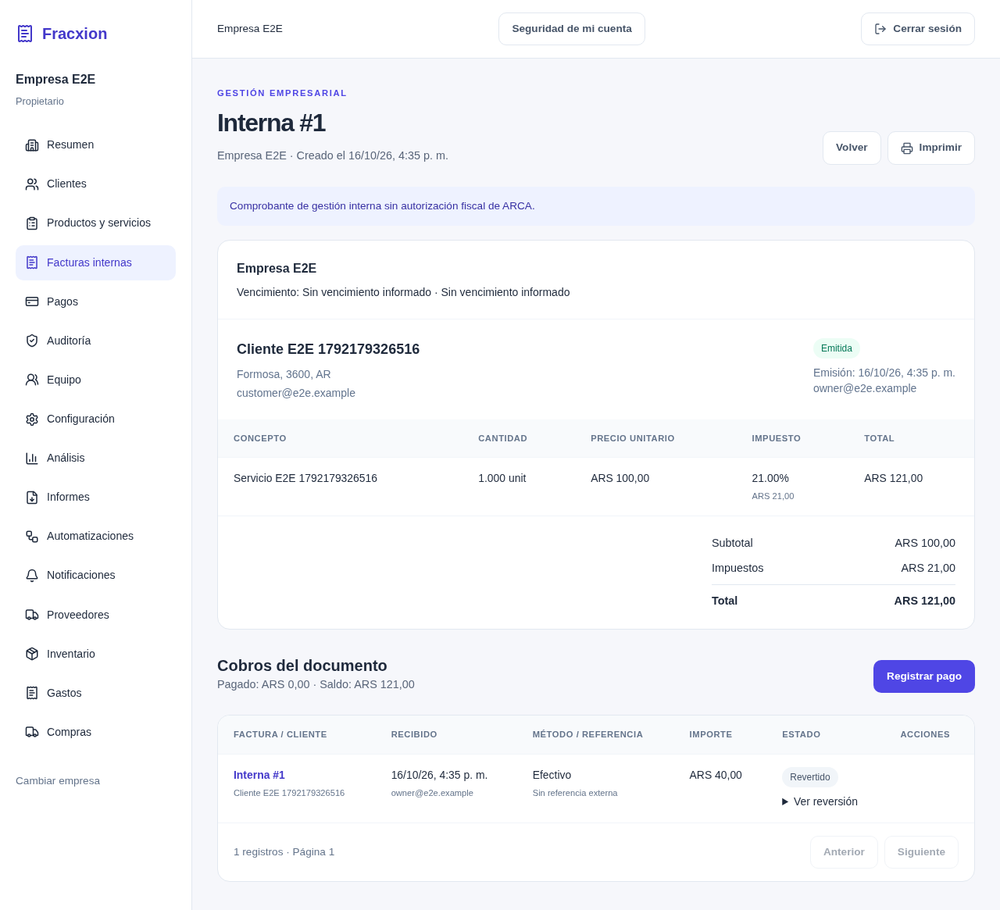

# Fracxion

**Gestión comercial multiempresa, con permisos por rol, operaciones trazables y datos aislados en el backend.**

Fracxion es una aplicación full stack para administrar clientes, productos, facturas internas, cobros, compras, gastos e inventario desde un mismo lugar. Una cuenta puede trabajar con varias empresas sin mezclar su información: cada operación se valida según la empresa activa y el rol del usuario.

[](https://github.com/nelsonvis3/fracxion-facturador/actions/workflows/ci.yml)

**[Caso de estudio](https://nelsonsivisstum.vercel.app/proyectos/fracxion/)** · **Demo pública: pendiente** · **[Documentación técnica](docs/ARQUITECTURA.md)**


> **English overview:** Fracxion is a multi-company business management application built with Next.js, Django REST Framework, and PostgreSQL. It provides internal invoicing, payments, purchases, expenses, inventory, and reporting. Tenant-scoped queries, role-based access, database transactions, and audit records protect the integrity of each company's data. The free-tier deployment configuration is prepared and locally tested; a public demo has not yet been released.

## El problema que resuelve

Una aplicación para varias empresas necesita algo más que mostrar una lista de facturas. Debe impedir que un usuario consulte datos ajenos, evitar números duplicados cuando dos operaciones ocurren a la vez y conservar un historial fiable de cobros e inventario. Fracxion aborda estas reglas **en el servidor y en la base de datos**, no solo en la interfaz.

## Funcionalidades principales

- **Empresas y accesos.** Una cuenta puede pertenecer a varias empresas con roles `owner`, `admin`, `accountant`, `sales` y `viewer`. Incluye verificación de correo, recuperación de contraseña, invitaciones y MFA opcional con TOTP.
- **Clientes y catálogo.** Productos y servicios con SKU, precios, moneda e impuestos. Los registros se desactivan sin borrar su historial documental.
- **Facturación y cobros internos.** Facturas con hasta 100 líneas, totales calculados por el servidor, numeración correlativa por empresa, cobros parciales y reversiones auditables.
- **Compras, gastos e inventario.** Flujo de compras a proveedores, movimientos de stock, control de existencias y seguimiento de pagos y gastos.
- **Reportes y automatizaciones.** Resúmenes de ventas y saldos, exportaciones CSV/Excel/PDF, alertas y trabajos procesados por un worker.



## Tecnologías y arquitectura

| Área | Implementación |
| --- | --- |
| Frontend | Next.js 16.4.2, React 19, TypeScript, Tailwind CSS 4 |
| Backend | Python 3.14, Django 5.2, Django REST Framework |
| Datos | PostgreSQL 17; Redis para caché y límites compartidos |
| Infraestructura | Docker Compose, Gunicorn y Caddy; perfil alternativo Netlify + Render + Neon |
| Correo | SMTP; transporte HTTPS de Brevo preparado para el perfil Render |
| Calidad | Django TestCase, Coverage, Ruff, Playwright, ESLint y GitHub Actions |

El código de Django está dividido por dominio: [`accounts`](backend/accounts), [`tenancy`](backend/tenancy), [`customers`](backend/customers), [`catalog`](backend/catalog), [`billing`](backend/billing), [`operations`](backend/operations), [`analytics`](backend/analytics), [`reports`](backend/reports), [`automation`](backend/automation) y [`auditlog`](backend/auditlog).

La interfaz Next.js utiliza una API de Django REST Framework. PostgreSQL conserva los datos y las tareas durables. Redis se emplea para caché y controles compartidos; no es la fuente de verdad de facturas, pagos o trabajos.

## Decisiones técnicas destacadas

### Aislamiento entre empresas

[`TenantAccessPermission`](backend/tenancy/permissions.py) comprueba membresía y permisos. Los [mixins de tenancy](backend/tenancy/mixins.py) restringen las consultas a la empresa solicitada. Además, al crear documentos se valida que clientes y productos pertenezcan a esa misma empresa; conocer el identificador de otra empresa no concede acceso a sus registros.

### Consistencia de importes y operaciones concurrentes

El servidor recupera los precios del catálogo y calcula con `Decimal` y `ROUND_HALF_UP` en [`billing/services.py`](backend/billing/services.py). Para emitir o cobrar, utiliza `transaction.atomic()`, bloqueos con `select_for_update()` y restricciones únicas de PostgreSQL. Así se evitan numeraciones repetidas y cobros que superen el saldo disponible.

### Historial en lugar de borrado

Los pagos se corrigen mediante reversiones, y el inventario se registra como movimientos en [`operations/models.py`](backend/operations/models.py). Cada operación relevante comparte una transacción con su evento de auditoría. La clave de idempotencia reduce el riesgo de repetir movimientos ante un reintento.

### Seguridad y despliegue de bajo costo

El perfil alternativo de despliegue añade un proxy de Netlify que reenvía solicitudes a Render por HTTPS. Django autentica ese proxy antes de confiar en metadatos de IP o esquema; la configuración para Neon exige PostgreSQL con TLS. Se implementó también un backend de correo con la API HTTPS de Brevo y pruebas de los casos de error. Estos componentes forman parte de la **preparación técnica**, no de una demo ya desplegada.

La explicación detallada de las decisiones está en [Arquitectura](docs/ARQUITECTURA.md).

## Ejecutar en local

Requisitos: **Python 3.14**, **Node.js 22**, **PostgreSQL** y npm. El entorno local necesita una base PostgreSQL y un usuario con permisos para crear y migrar tablas.

Desde la raíz del repositorio, preparar PostgreSQL:

```bash
createuser --pwprompt facturador
createdb --owner=facturador facturador
```

### Backend

```bash
cd backend
python3.14 -m venv .venv
.venv/bin/python -m pip install -r requirements-dev.txt
cp .env.example .env
# Configurar DB_PASSWORD y el resto de variables locales en backend/.env
.venv/bin/python manage.py migrate
.venv/bin/python manage.py runserver localhost:8000
```

### Frontend

En otra terminal, desde la carpeta `frontend/`:

```bash
cp .env.example .env.local
npm ci
npm run dev
```

Abrir **http://localhost:3000**. El registro inicial crea la empresa y asigna al usuario el rol de propietario. Para variables de entorno y solución de problemas, consultar [Desarrollo](docs/DESARROLLO.md).

## Pruebas

Desde `backend/`, con PostgreSQL configurado y las dependencias de desarrollo instaladas:

```bash
.venv/bin/coverage run manage.py test --settings=config.test_settings --noinput
.venv/bin/coverage report --fail-under=85
```

Desde `frontend/`:

```bash
npm run lint
npm run typecheck
npm run test:e2e
```

También existen pruebas específicas para el proxy Netlify y la supervisión de procesos. La [guía de despliegue gratuito](docs/DESPLIEGUE_GRATUITO.md) documenta una ejecución local de **381 pruebas de Django el 22 de octubre de 2026**, seguida de nuevas comprobaciones específicas de hosting y seguridad. Esos resultados describen las verificaciones realizadas entonces; **no equivalen a una validación del despliegue en proveedores externos**. Las pruebas E2E requieren un entorno aislado según [Testing](docs/TESTING.md).

## Despliegue y estado actual

**El sistema funciona en entornos de desarrollo y tiene infraestructura de despliegue preparada, pero no se anuncia una demo pública operativa.** Hay dos caminos documentados:

- [Docker Compose, Gunicorn y Caddy](docs/OPERATIONS.md), para un servidor administrado.
- [Netlify + Render + Neon + Redis + Brevo](docs/DESPLIEGUE_GRATUITO.md), orientado a una demo de bajo tráfico con recursos gratuitos. Incluye archivos [`netlify.toml`](netlify.toml) y [`render.yaml`](render.yaml), controles de proxy y pruebas locales. Aún faltan provisionar los servicios y validar sesiones, correos reales, backups y consumo de recursos en producción.

**Límites funcionales:** las facturas son **documentos internos no fiscales**: no se integran con ARCA ni emiten CAE. Las notas de crédito y débito están modeladas, pero su emisión no está habilitada. Tampoco hay conciliación bancaria, suscripciones SaaS ni pruebas de carga concluyentes.

## Documentación

- [Desarrollo local y variables de entorno](docs/DESARROLLO.md)
- [Arquitectura y decisiones](docs/ARQUITECTURA.md)
- [API](docs/API.md)
- [Testing](docs/TESTING.md)
- [Operación con Docker Compose](docs/OPERATIONS.md)
- [Preparación de despliegue gratuito](docs/DESPLIEGUE_GRATUITO.md)

## Aprendizajes

Este proyecto me obligó a pensar en reglas que una interfaz por sí sola no puede garantizar: el aislamiento entre empresas, los bloqueos para operaciones simultáneas y la trazabilidad de los cambios. También aprendí a separar las tareas durables de un proceso web y a verificar los límites de seguridad entre un proxy público y la API.

## Licencia

Código disponible bajo licencia [MIT](LICENSE).
