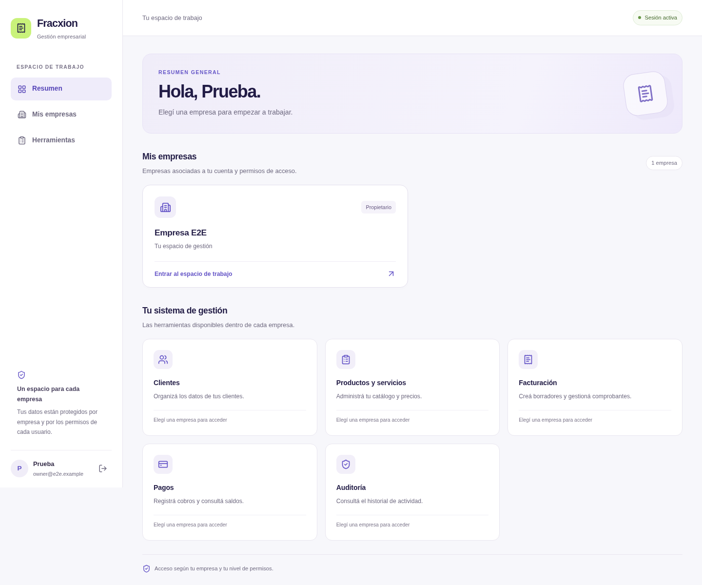
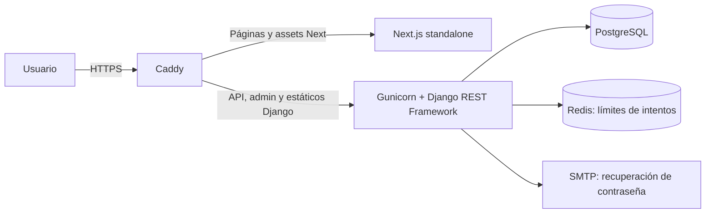

# Fracxion — Gestión y facturación interna

Aplicación full stack para administrar clientes, productos y servicios, comprobantes internos y cobros de varias empresas. Cada usuario accede mediante una membresía con permisos definidos por empresa. Las operaciones comerciales conservan un historial de auditoría.

**Alcance:** los documentos emitidos son comprobantes de gestión interna. No tienen autorización fiscal de ARCA, CAE ni numeración fiscal. El proyecto incluye registro público con creación de empresa; no incluye suscripciones SaaS ni cobro de planes.



Captura real del flujo automatizado en Chromium, con empresa, cuentas y operaciones sintéticas. No contiene datos de clientes reales.

Otras vistas verificadas: [dashboard móvil](docs/screenshots/dashboard-mobile.png), [resumen de empresa](docs/screenshots/company-dashboard-desktop.png), [resumen móvil](docs/screenshots/company-dashboard-mobile.png) y [factura con historial de cobros](docs/screenshots/invoice.png).

## Funcionalidad

| Módulo | Comportamiento disponible |
| --- | --- |
| Acceso | Registro de cuenta y empresa, login por correo, sesión con cookies, logout, selección de empresa y recuperación con enlace de un solo uso. |
| Clientes | Alta, edición, búsqueda, filtros, paginación, desactivación y reactivación. Países y provincias/estados proceden de la API de referencia. |
| Catálogo | Productos y servicios, SKU, unidad, moneda, precio e impuesto; edición y cambio de estado sin eliminación física. |
| Facturas internas | Borradores de hasta 100 líneas, precios del catálogo, snapshots del cliente, emisión con numeración por empresa, detalle e impresión desde el navegador. |
| Cobros | Pagos parciales o totales, métodos y referencias, saldo pendiente y reversión con motivo conservando el pago original. |
| Auditoría | Consulta por acción y entidad, con actor, fecha, cambios y metadatos. Reservada a propietarios y administradores. |
| Administración | Django Admin para cuentas, empresas y membresías; registros comerciales en modo lectura. Comando de alta inicial de empresa. |

La interfaz adapta la navegación a escritorio y móvil. Incluye estados de carga, errores, formularios, diálogos nativos y acciones ajustadas al rol. El backend vuelve a comprobar todos los permisos, independientemente de la interfaz.

Para registrar un pago, primero guardar y emitir el documento desde **Facturas internas**: abrir el borrador y pulsar **Emitir factura interna** con rol propietario o administrador. Después, en **Pagos → Registrar pago**, el campo **Factura emitida** ofrece los documentos emitidos de esa empresa con número, cliente y saldo. Los borradores no aparecen. Si no hay emitidas, el formulario lo explica y ofrece acceso a Facturas; una búsqueda sin coincidencias muestra un mensaje diferente. Propietarios, administradores y contadores pueden registrar el cobro, sin superar el saldo pendiente.

## Arquitectura



La instalación de referencia utiliza un solo dominio. El navegador consulta `/api/` con cookies; Caddy dirige cada ruta al servicio correspondiente. PostgreSQL guarda los datos comerciales y las sesiones. Redis comparte los límites de autenticación entre workers.

| Capa | Tecnología |
| --- | --- |
| Backend | Python 3.14, Django 5.2.18, Django REST Framework 3.18.1 |
| Datos | PostgreSQL 17, psycopg 3, restricciones, transacciones y bloqueos de filas |
| Frontend | Next.js 16.4.0, React 19.3.0, TypeScript, Tailwind CSS 4 |
| Producción | Gunicorn, WhiteNoise, Redis 8, Caddy 2, Docker Compose |
| Verificación | Django TestCase/TransactionTestCase, Coverage, Ruff, ESLint, TypeScript, Playwright, pip-audit y npm audit |

Las dependencias Python están fijadas en `backend/requirements.txt`; las de desarrollo están separadas. El frontend utiliza `package-lock.json` y `npm ci` para instalaciones reproducibles.

## Permisos por empresa

| Operación | owner | admin | accountant | sales | viewer |
| --- | :---: | :---: | :---: | :---: | :---: |
| Consultar clientes, catálogo, facturas y pagos | Sí | Sí | Sí | Sí | Sí |
| Crear/editar clientes y catálogo | Sí | Sí | — | — | — |
| Crear borradores y emitir | Sí | Sí | — | — | — |
| Registrar pagos | Sí | Sí | Sí | — | — |
| Revertir pagos | Sí | Sí | — | — | — |
| Consultar auditoría | Sí | Sí | — | — | — |

Un superusuario de plataforma no obtiene acceso a las API de empresa sin una membresía. Las membresías inactivas, empresas desactivadas y usuarios inactivos quedan excluidos. La gestión de cuentas y membresías se realiza desde Django Admin, con una cuenta de plataforma autorizada.

El registro público en `/register` crea una cuenta normal, una empresa nueva y una membresía `owner`; abre la sesión y lleva al resumen de esa empresa. Solicita nombre, apellido opcional, correo, nombre de empresa y contraseña con confirmación. No acepta roles, privilegios de plataforma ni empresas existentes en el payload. Cuenta, empresa, membresía y evento de auditoría se guardan juntos o se revierten juntos. El correo se valida por formato; este flujo no incluye verificación por enlace.

## Integridad y seguridad

- La empresa se obtiene de la URL y la membresía validada. Las consultas y relaciones de clientes, productos y documentos se limitan a esa empresa.
- Las operaciones comerciales y sus eventos de auditoría se guardan en la misma transacción. Un fallo en la auditoría revierte la escritura.
- Los importes usan `Decimal`. El subtotal de cada línea se redondea a centavos con `ROUND_HALF_UP`; el impuesto se calcula sobre ese subtotal. La API devuelve importes como cadenas. El frontend presenta valores y no calcula totales contables.
- La emisión bloquea la empresa, comprueba las líneas y asigna un número único. Los snapshots conservan los datos y precios del momento de creación del borrador. Cambiar un cliente o producto no reescribe documentos anteriores.
- Las API no ofrecen edición ni eliminación de facturas emitidas o pagos. Una reversión genera un registro separado y restituye el saldo. Otras integraciones deben utilizar los servicios comerciales: los controles de modelos y API no sustituyen controles sobre SQL directo.
- Los pagos se validan bajo bloqueo y no pueden superar el saldo. Una referencia externa no se reutiliza dentro de una empresa y un método, incluso después de una reversión.
- Cookies HttpOnly; en producción, Secure, HTTPS y HSTS. El token CSRF enmascarado se entrega por JSON y se renueva antes de las escrituras. Las respuestas de API utilizan `Cache-Control: private, no-store`.
- Logout y una sesión inválida en rutas privadas descartan el documento del navegador para eliminar páginas ocultas y datos de la sesión anterior retenidos por el router.
- JSON limitado a 2,5 MiB y 100 niveles, con rechazo de enteros excesivos, números no finitos, NUL y Unicode inválido. Login y recuperación acotan la longitud de credenciales antes del hashing. El registro conserva sus mensajes de validación por campo.
- Login y recuperación tienen límites de intentos. La recuperación devuelve una respuesta genérica para evitar revelar cuentas. El enlace vence en una hora y deja de servir después del cambio de contraseña.
- El registro admite diez intentos por IP en quince minutos, aplica los [validadores de contraseña de Django](https://docs.djangoproject.com/en/5.2/topics/auth/passwords/#password-validation) y rechaza correos duplicados normalizados, incluso ante registros concurrentes. Devuelve errores por campo; una cuenta existente puede iniciar sesión o recuperar su acceso.
- La auditoría omite el contenido libre de notas y descripciones. Conserva otros datos estructurados, por lo que su acceso también está restringido.

La validación de documentos, teléfonos y direcciones verifica formato y coherencia. No confirma identidad, existencia del domicilio ni titularidad de un teléfono. Se conserva compatibilidad con códigos postales argentinos históricos de cuatro dígitos y con PATCH que no modifica campos heredados.

## Desarrollo local

Requisitos: Python 3.14, Node.js 22 con npm y PostgreSQL. Si ya existen archivos de entorno, conservarlos y ajustar solo las variables necesarias.

### Backend

```sh
cd backend
python3.14 -m venv .venv
.venv/bin/python -m pip install -r requirements-dev.txt
cp -n .env.example .env
```

Configurar `DB_*` en `backend/.env` para una base local y un usuario con permisos sobre ella. Reemplazar la contraseña de muestra. Una vez creada la base:

```sh
.venv/bin/python manage.py migrate
.venv/bin/python manage.py runserver localhost:8000
```

Una vez iniciado el frontend, utilizar **Crear cuenta** desde el login para registrar al propietario y su empresa. Como alternativa de alta administrativa, `manage.py create_workspace --email propietario@example.com --name "Mi empresa" --slug mi-empresa` solicita la contraseña de forma privada y puede vincular una cuenta existente activa. Ninguno de estos flujos crea un superusuario. Para administrar usuarios y asignar membresías, utilizar `manage.py createsuperuser` y `/admin/`.

### Frontend

En otra terminal:

```sh
cd frontend
cp -n .env.example .env.local
npm ci
npm run dev
```

Abrir `http://localhost:3000`. Usar el mismo hostname en frontend y backend; no mezclar `localhost` con `127.0.0.1`, porque las cookies pertenecen al host. En desarrollo, los enlaces de recuperación aparecen en la terminal del backend.

Para ejecutar el build local:

```sh
npm run build
env PORT=3000 HOSTNAME=localhost npm run start
```

`postbuild` copia los assets al directorio standalone. `NEXT_PUBLIC_API_BASE_URL` se incorpora durante la compilación; cambiarla exige reconstruir. Docker compila con valor vacío para utilizar la API del mismo dominio.

## API

Todas las rutas llevan `/` final. Las listas comerciales se paginan en bloques de 25 y devuelven `count`, `next`, `previous` y `results`.

| Método | Ruta | Uso |
| --- | --- | --- |
| GET | `/api/auth/csrf/` | Obtener `csrfToken` y su cookie. |
| POST | `/api/auth/register/` | Crear cuenta y empresa con sesión; requiere CSRF. |
| POST | `/api/auth/login/` | JSON con `email` y `password`; requiere CSRF. |
| POST | `/api/auth/logout/` | Finalizar sesión; requiere CSRF. |
| GET | `/api/auth/me/` | Cuenta actual. |
| GET | `/api/auth/tenants/` | Empresas y roles de la cuenta. |
| POST | `/api/auth/password-reset/` | Solicitar enlace con `email`. |
| POST | `/api/auth/password-reset/confirm/` | Restablecer con `uid`, `token`, `password` y `password_confirm`. |
| GET | `/api/reference/countries/` | Países ISO disponibles. |
| GET | `/api/reference/countries/{code}/subdivisions/` | Provincias/estados del país. |
| GET, POST | `/api/tenants/{tenant_id}/customers/` | Consultar o crear clientes. |
| GET, PUT, PATCH | `/api/tenants/{tenant_id}/customers/{id}/` | Consultar o actualizar un cliente. |
| POST | `/api/tenants/{tenant_id}/customers/{id}/deactivate/` | Desactivar sin borrar. |
| GET, POST | `/api/tenants/{tenant_id}/products/` | Consultar o crear catálogo. |
| GET, PUT, PATCH | `/api/tenants/{tenant_id}/products/{id}/` | Consultar o actualizar un producto. |
| POST | `/api/tenants/{tenant_id}/products/{id}/deactivate/` | Desactivar sin borrar. |
| GET, POST | `/api/tenants/{tenant_id}/invoices/` | Consultar o crear borradores. |
| GET | `/api/tenants/{tenant_id}/invoices/{id}/` | Detalle con líneas, pagado y saldo. |
| POST | `/api/tenants/{tenant_id}/invoices/{id}/issue/` | Emitir una vez. |
| GET, POST | `/api/tenants/{tenant_id}/payments/` | Consultar o registrar un pago. |
| GET | `/api/tenants/{tenant_id}/payments/{id}/` | Detalle de pago y reversión. |
| POST | `/api/tenants/{tenant_id}/payments/{id}/reverse/` | Revertir con `reason`. |
| GET | `/api/tenants/{tenant_id}/audit-events/` | Historial con filtros. |

La reactivación de clientes y productos usa PATCH con `{"is_active": true}`. Las referencias requieren sesión. Las peticiones que cambian estado envían `X-CSRFToken` y conservan las cookies. Una sesión ausente produce 401; un rol insuficiente, 403; un objeto ajeno dentro de una empresa autorizada, 404.

Ejemplo de registro:

```json
{
  "first_name": "Nombre",
  "last_name": "Apellido",
  "company_name": "Mi empresa",
  "email": "propietario@example.com",
  "password": "TuContraseñaÚnicaYSegura",
  "password_confirm": "TuContraseñaÚnicaYSegura"
}
```

Responde 201 con `user`, `tenant` y `csrfToken` renovado. No devuelve contraseñas. Un correo duplicado o datos inválidos producen 400, el límite de intentos produce 429 y una sesión ya abierta debe cerrarse antes de registrar otra cuenta. No requiere migraciones nuevas: utiliza los modelos existentes de cuenta, empresa y membresía.

Ejemplo del cuerpo para crear un borrador:

```json
{
  "customer": "UUID-del-cliente",
  "currency": "ARS",
  "lines": [{ "product": "UUID-del-producto", "quantity": "2.500" }],
  "notes": "Condiciones comerciales"
}
```

No se envían precios ni totales: se obtienen del catálogo autorizado. Todos los productos deben compartir la moneda del documento. OpenAPI de los recursos DRF está en `/api/docs/` y `/api/schema/`, con sesión. Las vistas Django de autenticación se describen en esta tabla.

## Pruebas y calidad

Resultados locales de la revisión del 10 de octubre de 2026:

| Comprobación | Resultado |
| --- | --- |
| Backend sobre PostgreSQL aislado | 216 pruebas aprobadas |
| Cobertura de sentencias del backend | 91%, excluyendo pruebas, migraciones y entrypoints |
| Playwright | 15 escenarios aprobados: 11 de navegador y 4 de seguridad API, sin excepciones JavaScript ni 5xx en los flujos UI |
| Dashboard en navegador | Escritorio, tablet y móvil (1440/768/390/320 px), contraste, contadores reales, teclado y permisos |
| Ruff, ESLint y TypeScript/build | Aprobados |
| Migraciones y OpenAPI | Sin cambios pendientes; esquema válido sin advertencias |
| Imágenes Docker y stack HTTPS local | Construcción y arranque verificados |

Las pruebas concurrentes usan PostgreSQL real; SQLite no reproduce los bloqueos de filas. E2E utiliza `test_facturador_e2e` y cuentas sintéticas, con una protección explícita en el script de preparación. Ver [guía de pruebas](docs/TESTING.md), [auditoría](docs/AUDIT.md) y [log de errores, correcciones y verificaciones](docs/AUDIT_LOG.md).

GitHub Actions incluye backend, build y E2E. El workflow se entrega configurado; su ejecución en GitHub se verifica después de publicar el repositorio.

### Dependencias

En la revisión local, `pip-audit` no informó vulnerabilidades conocidas y `npm audit --omit=dev` informó cero. La auditoría completa de npm informa cinco paquetes de desarrollo afectados por una misma cadena de ESLint/Next, originada en `braces`. La corrección sugerida por npm implica bajar `eslint-config-next` a Next 14. Se conserva el aviso documentado y la configuración compatible con Next 16. Revisar futuras actualizaciones; no ejecutar `npm audit fix --force` sin comprobar el cambio de versión. Detalle en [AUDIT.md](docs/AUDIT.md).

## Despliegue y operación

La configuración de producción está en `compose.yaml`, los Dockerfiles y `deploy/Caddyfile`. Consultar [OPERATIONS.md](docs/OPERATIONS.md) para configurar dominio, secretos, SMTP, migraciones, propietario inicial, backups y actualizaciones.

El servidor rechaza DEBUG en producción, claves de muestra, hosts sin configurar, cookies inseguras, HTTPS desactivado, redes de proxy ausentes/inválidas cuando confía en HTTPS del proxy, ausencia de Redis o recuperación sin HTTPS/SMTP. `/health/` comprueba el proceso; `/ready/` verifica PostgreSQL y caché. El arranque rechaza migraciones pendientes.

La validación local no acredita certificados públicos, entrega real de correo, backups externos ni capacidad bajo carga. Esos puntos se comprueban en la infraestructura elegida. El repositorio no incluye credenciales reales ni una URL de producción.

## Organización

```text
backend/
  accounts/        Sesiones, usuarios y recuperación
  tenancy/         Empresas, membresías, permisos y contexto
  customers/       Clientes y validaciones
  catalog/         Productos y servicios
  billing/         Documentos, pagos y servicios transaccionales
  auditlog/        Historial de operaciones
  config/          Entornos, rutas, referencia, salud y middleware
frontend/
  src/app/         Rutas y módulos
  src/components/  Formularios y navegación compartidos
  src/lib/         Cliente HTTP, tipos y API
  e2e/             Escenarios Playwright
deploy/            Proxy HTTPS
docs/              Auditoría, pruebas y operación
.github/workflows/ Comprobaciones automatizadas
```

Las reglas comerciales residen en el backend. Una funcionalidad nueva debe conservar el aislamiento por empresa, roles, precisión decimal y auditoría transaccional. Notas de crédito/débito, conciliación automática, inventario, integración fiscal, invitaciones de miembros y planes de suscripción necesitan sus propios flujos y criterios de aceptación antes de incorporarse.
