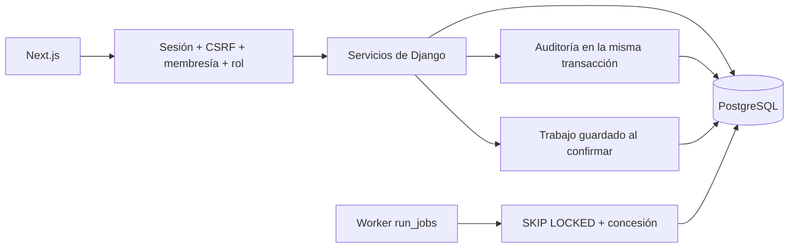

# Arquitectura

Fracxion es un monolito modular: un backend Django dividido por dominio y un frontend Next.js que solo habla con su API. Todas las empresas comparten base y tablas; el aislamiento se hace en la aplicación, con la empresa de la URL, la membresía activa y el rol. No hay esquemas por empresa ni RLS.

## Módulos del backend

| Módulo | Responsabilidad |
| --- | --- |
| `accounts` | Cuentas, sesiones, CSRF, registro, login, recuperación, MFA, cambio de contraseña e inventario de sesiones |
| `tenancy` | Empresas, membresías, invitaciones y configuración. Protege al último propietario activo |
| `customers`, `catalog` | Clientes y catálogo de cada empresa. El catálogo es la fuente de precios de los documentos nuevos |
| `billing` | Borradores, emisión, copias históricas, cobros y reversiones. Las facturas emitidas no cambian |
| `auditlog` | Eventos de negocio, guardados en la misma transacción que la operación |
| `analytics` | Totales por moneda y período |
| `reports` | Conjuntos de datos y exportación a CSV, Excel y PDF |
| `automation` | Cola de trabajos, reglas programadas, intentos, notificaciones y salud del worker |
| `operations` | Proveedores, movimientos de inventario, compras, recepciones, gastos y sus pagos |

## Orden de bloqueos

Cuando una operación necesita varios bloqueos, el orden es siempre **cuenta → empresa → membresía u objeto**. Las mutaciones de catálogo, clientes, facturación e inventario bloquean la empresa antes que el producto o el cliente. Mantener ese orden evita que una edición del catálogo y una emisión se bloqueen entre sí.

Solo un propietario puede administrar a otros propietarios o administradores, y nadie puede desactivar al último propietario activo de una empresa. Django Admin aplica las mismas reglas.

## Cuentas y sesiones

- **Invitaciones:** token aleatorio guardado como hash SHA-256, con vencimiento, uso único y nueva validación de quien invitó. El token viaja en el fragmento del link, no en la URL que llega al servidor.
- **Inventario de sesiones:** muestra dispositivo aproximado, IP y última actividad, sin exponer la `session_key`. La actividad se actualiza como mucho cada 5 minutos. "Cerrar las otras sesiones" pide la contraseña y cambia `User.session_version`, que forma parte del hash de autenticación, así que invalida también sesiones viejas.
- **MFA:** TOTP opcional con códigos de recuperación guardados como hash y semilla cifrada con Fernet (`MFA_ENCRYPTION_KEYS`). La contraseña correcta abre un desafío de 5 minutos y la sesión se completa con el código. Un middleware rechaza las sesiones sin segundo factor, también en Django Admin.
- **Verificación de email:** se pide desde "Seguridad de mi cuenta". El link es una firma de Django con vencimiento de 24 horas y solo vale el último enviado.
- **Cobros repetidos:** `POST payments/` acepta un header `Idempotency-Key`. La misma clave con el mismo contenido devuelve el cobro existente; con otro contenido responde 409.

## Analítica e informes

- Facturado: total de las facturas emitidas en el período, por fecha de emisión.
- Cobrado: pagos por fecha de recepción, sin los revertidos.
- Saldo y vencido: saldo actual de las facturas emitidas en el período. No reconstruye un cierre contable.
- Cada informe usa una sola moneda: no se suman ARS y USD.

Los informes que hacen varias consultas las leen en una transacción `REPEATABLE READ, READ ONLY`, para que un cobro que entra a mitad de camino no deje secciones que no cierran. El CSV neutraliza fórmulas en el texto de los usuarios, el Excel guarda los valores como texto y el PDF se arma con ReportLab sin imágenes ni links externos.

La descarga inmediata admite hasta 1.000 filas. Un informe en segundo plano admite hasta 10.000 filas y 20 MiB, y su archivo vence a los 7 días.

## Cola de trabajos

`Job` es a la vez la solicitud y la unidad de la cola, guardada en PostgreSQL. El worker (`manage.py run_jobs`) solo ve trabajos ya confirmados, así que no hay un mensaje que pueda publicarse antes del commit ni un broker que tenga la única copia.

- El worker toma trabajos con `SELECT ... FOR UPDATE SKIP LOCKED` y una concesión de 10 minutos con UUID. Si la concesión vence, otro worker puede retomarlo y el resultado del anterior se descarta.
- Cada ejecución corre en un proceso hijo con un límite de 8 minutos.
- Hasta 3 intentos, con espera de 30 segundos que se duplica en cada reintento. Cada intento queda registrado.
- Las reglas son diarias, semanales (lunes) o mensuales (día 1), en la hora local de la empresa. Si el worker estuvo caído, los períodos perdidos se agrupan en una sola ejecución.
- Si el worker se cae, la API sigue funcionando y los trabajos esperan en la base.

Se eligió PostgreSQL en lugar de Celery porque hay solo dos tipos de trabajo acotados (informes y alertas de vencimiento). Un broker dedicado tiene sentido cuando haya una necesidad medida.

## Operaciones

- **Inventario:** un solo depósito, sin reservas. El stock sale de la suma de movimientos y el frontend nunca escribe un saldo. Una reversión agrega otro movimiento y conserva el original; no se puede quedar en negativo. La facturación no mueve stock.
- **Compras:** borrador, confirmación con copias históricas y hasta 100 líneas. Las recepciones pueden ser parciales, son idempotentes y suman stock solo para productos físicos. Cerrar un pedido conserva lo recibido y cancela el resto.
- **Gastos:** borrador, registro con importe neto y tasa de impuesto, pagos parciales o totales y reversiones. Un gasto con pagos no se anula hasta revertirlos. Los adjuntos son PNG o JPEG de hasta 512 KiB, recodificados al subirlos.

## Observabilidad

Cada petición recibe un UUID que viaja como `X-Request-ID` y queda en la auditoría. Los logs son JSON con campos limitados: no guardan cuerpos, cookies ni tokens.
