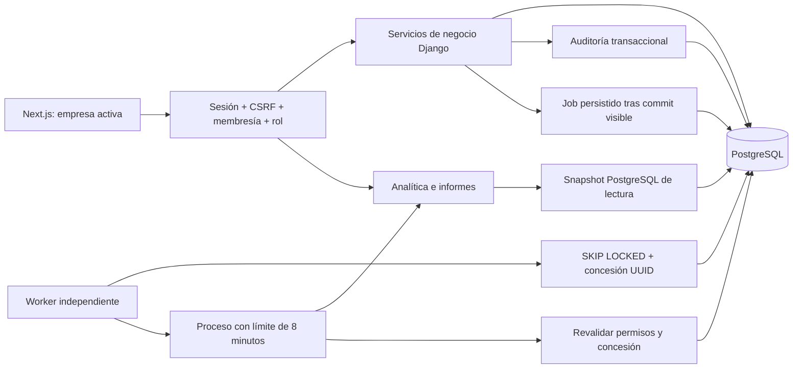

# Arquitectura empresarial — trabajo continuo

Estado local en desarrollo, 2026-10-14. `ENTERPRISE_TESTING.md` distingue código, pruebas y limitaciones de entorno. La auditoría inicial describe el baseline anterior; este documento describe las decisiones nuevas. No supone despliegue público ni certificación externa.

## Límites y responsabilidades

El sistema conserva el monolito modular Django y Next.js. La empresa de cada solicitud procede de la URL y de una membresía activa, nunca de un identificador confiado del cuerpo. El aislamiento es por consultas y autorización de aplicación sobre tablas compartidas; no se afirma RLS ni esquemas separados.

| Módulo | Responsabilidad |
| --- | --- |
| accounts | Cuenta, sesiones y CSRF; registro, login, recuperación, inventario/revocación de accesos y cambio de contraseña; auditoría y administración de plataforma. |
| tenancy | Empresas, membresías, invitaciones y preferencias. Servicios explícitos para cambios de roles y protección del último propietario activo. |
| customers / catalog | Datos comerciales por empresa; catálogo fuente de precios/unidades para nuevos documentos. |
| billing | Borradores, emisión interna, snapshots históricos, cobros y reversiones. Decimal y transacciones; las emitidas siguen siendo inmutables. |
| auditlog | Eventos persistentes de negocio dentro de la misma transacción. Sin contraseñas, tokens, logos ni texto libre innecesario. |
| analytics | Lecturas agregadas por moneda y período; saldos actuales y cobros efectivos, consultas separadas para evitar multiplicación de totales. |
| reports | Conjuntos de datos y representación CSV/XLSX/PDF. Texto controlado, importes exactos, contenido privado. |
| automation | Trabajos durables, reglas, intentos, concesiones con vencimiento, resultados privados, notificaciones y salud del worker. |
| operations | Proveedores, libro de movimientos de inventario, categorías, gastos y pagos/reversiones de cuentas por pagar. Verificación registrada por separado. |

## Configuración y documentos

`BusinessSettings` amplía `Tenant` mediante relación uno a uno. Los GET no crean filas por efecto secundario. Logos PNG/JPEG se decodifican y recodifican con Pillow, se quita metadata y contenido añadido y se guardan como binario privado. No existe URL pública de logos empresariales.

El plazo predeterminado solo participa en nuevos borradores: se cuenta desde el día de creación en la zona empresarial. La fecha se fija antes de emitir y admite ausencia explícita. Los documentos históricos permanecen sin fecha si no la tenían. Nombre/contacto del emisor y pie se conservan como snapshots para que cambios posteriores no reescriban la representación histórica.

No hay conversión de moneda ni autorización fiscal ARCA. Las notas de crédito/débito no se activan por la mera presencia de opciones en modelos.

## Identidad, autorización y concurrencia

Orden compartido cuando se necesitan esos bloqueos: **cuenta objetivo → empresa → membresía/objeto**. Las cuentas se bloquean con `no_key=True` para permitir comprobaciones FK que no cambian su identificador. Las empresas se bloquean antes de productos/clientes y auditoría en mutaciones del catálogo, clientes, facturación e inventario. Así se evita invertir el orden entre modificación del catálogo y emisión/movimientos.

Solo propietarios administran otros propietarios/administradores. Desactivar una membresía o una cuenta no puede quitar el último propietario activo. Admin aplica las mismas reglas. Un operador de plataforma limitado no puede consultar/editar cuentas staff/superusuario mediante UserAdmin ni cambiarles la contraseña o correo. La comprobación no depende de ocultar botones.

Las invitaciones tienen token aleatorio, digest SHA-256, expiración, rotación, uso único y revalidación de quien invitó. El enlace lleva token en fragmento; las APIs de gestión no lo devuelven. La aceptación existente exige sesión del destinatario. El envío actual es posterior al commit y registra fallo; no se considera una cola durable de correo ni garantiza entrega SMTP.

El inventario de sesiones devuelve UUID públicos, dispositivo aproximado, IP observada y actividad; no devuelve `session_key`, cookies ni datos codificados de autenticación. La actividad conocida se lee con una consulta adicional y se escribe como máximo cada cinco minutos. Las sesiones preexistentes se inventarían al usarse; su fecha de detección no se presenta como fecha original de login. La revocación individual elimina la sesión correspondiente. Revocar otros accesos exige contraseña actual e incrementa `User.session_version`, que participa en el hash de autenticación de Django; invalida incluso accesos antiguos no inventariados. Versión cero conserva el hash Django anterior y se respeta `SECRET_KEY_FALLBACKS`. Cambiar contraseña utiliza los validadores de Django y `update_session_auth_hash()` para conservar el dispositivo actual, revocando otros. Reset/Admin retiran las sesiones inventariadas afectadas. Los intentos fallidos de cambios sensibles se auditan fuera de su transacción revertida y con límite.

Los cobros aceptan `Idempotency-Key` opcional por compatibilidad: misma empresa y huella canónica recuperan el cobro; otro contenido responde 409. El formulario conserva la misma clave ante un reintento. La reversión no permite reutilizarla para cobrar nuevamente.

## Definiciones de analítica y exportación

- Facturado: total de facturas internas emitidas en el rango por fecha de emisión.
- Cobrado efectivo: pagos por fecha de recepción, excluyendo los revertidos actualmente.
- Saldo actual/vencido del período: saldo de las facturas emitidas dentro del rango. No reconstruye un cierre contable histórico.
- Un informe agrega una única moneda. No se suman ARS y USD ni se aplica cotización implícita.
- Las fechas se convierten en límites semiabiertos según zona empresarial. El período anterior tiene igual cantidad de días.
- El informe de movimientos muestra emisión, cobro y reversión por sus fechas registradas, sin inventar saldo inicial.

Los informes multiconsulta se leen en una transacción PostgreSQL `REPEATABLE READ, READ ONLY` cuando no existe transacción exterior. Una prueba concurrente verifica que un cobro confirmado entre dos agregaciones no produzca secciones incoherentes. El resultado siguiente sí incorpora el nuevo cobro.

CSV neutraliza prefijos de fórmula en texto de usuarios, incluidos espacios y normalización Unicode. XLSX escribe valores como texto para conservar precisión y evitar fórmulas. PDF usa texto escapado y tipografía incluida en ReportLab; no solicita imágenes o enlaces externos procedentes de datos. No se afirma soporte universal de glifos.

Descarga inmediata: máximo 1.000 filas. Trabajo durable: máximo 10.000 filas y 20 MiB de resultado. Los límites se comunican en interfaz y generan error explícito. Los binarios vencen a siete días y el worker elimina solo ese contenido regenerable, conservando metadatos, intentos y auditoría. Descargas revalidan tenant, rol y titular del trabajo; no hay enlaces públicos permanentes.

## Ejecución durable y recuperación

`Job` es simultáneamente solicitud persistente y unidad de cola. Un worker solo observa filas confirmadas, por lo que no se publica un mensaje antes del commit. No hay broker que sea la única copia del trabajo ni un paso DB→broker que pueda perderlo. No hay llamadas externas financieras en estos jobs.

La toma usa `SELECT FOR UPDATE SKIP LOCKED`. Cada intento adquiere UUID y concesión de diez minutos. Una concesión recuperada invalida el resultado de un proceso anterior. El proceso hijo tiene timeout de ocho minutos; una interrupción termina únicamente el hijo propio y hace recuperable la solicitud. Máximo tres intentos, espera inicial 30 segundos y backoff exponencial. Cada intento queda persistido. El error visible es un código; no se guarda el texto de excepciones potencialmente sensible.

Las notificaciones y la publicación del archivo se confirman junto con el estado completado. Unicidad por destinatario/empresa/efecto evita avisos duplicados. Una regla desactivada, empresa inactiva o permiso revocado cancela efectos pendientes. No se promete entrega exactamente una vez a servicios externos.

Reglas diarias, semanales (lunes) y mensuales (día 1), en hora local. Tras interrupción se agrupan intervalos omitidos en una ejecución para el período completo más reciente. No se envía una ráfaga de correos atrasados. Los recordatorios necesitan regla habilitada y preferencia empresarial; crean avisos internos de facturas con fecha y saldo positivo, con un máximo explícito de 1.000 documentos por ejecución. Un límite excedido queda fallido y requiere revisión; no se presenta una ejecución parcial como exitosa.

El worker publica latidos durante la espera y durante procesos largos. Su fallo degrada informes/avisos, mientras las operaciones sincrónicas siguen disponibles. El healthcheck del worker es independiente del readiness de la API.

Celery 5.6 anuncia soporte inicial de Python 3.14 en su changelog oficial. No se verificó su combinación real con Redis en este entorno. Se elige inicialmente la cola PostgreSQL para dos clases de trabajo acotadas; reconsiderar un broker dedicado cuando haya necesidad medida.

## Operaciones: reglas explícitas

Proveedores se desactivan y conservan relaciones históricas. Identificación comercial por empresa, búsqueda, edición y auditoría; notas libres no se copian a auditoría.

Inventario inicial de un único depósito lógico, sin reservas. Para este flujo **stock físico y disponible coinciden**. El seguimiento se habilita por producto físico. Existencias derivadas del libro de movimientos; el frontend nunca sobrescribe un saldo. Entradas/salidas usan cantidad positiva; ajustes son incrementos/decrementos firmados con motivo. Reversión agrega otro movimiento y conserva el original; no puede revertir una reversión ni generar saldo negativo. Cada registro conserva nombre/unidad históricos, autor y referencia.

La empresa y producto se bloquean antes de calcular saldo y registrar efecto/auditoría. Las claves de idempotencia y la restricción única evitan duplicación. No se permite cambiar unidad/tipo de un producto con historia que alteraría el significado de sus cantidades. La facturación no mueve stock automáticamente. No existe conversión de unidades o inventario valorizado implícito.

Compras, recepción, obligación y pago usan entidades y acciones separadas. Un pedido confirmado no aumenta stock ni registra una obligación o un pago. El sistema no se presenta como contabilidad de partida doble.

Los gastos ya tienen un flujo independiente: borrador editable, registro con snapshots, importe neto y tasa de impuesto explícita, total Decimal redondeado con la política existente, pagos parciales/totales y reversiones inmutables. Un gasto con pagos efectivos no se anula hasta revertirlos. Una anulación conserva el documento y motivo. El pago documenta un movimiento realizado; no llama a un banco. Categorías/proveedores permanecen relacionados al desactivarse. Adjuntos admiten únicamente PNG/JPEG recodificados, con 512 KiB de entrada y límites de dimensiones; PDF de terceros no está habilitado. Los informes de gastos/cuentas por pagar se filtran por proveedor, fecha del gasto y moneda; muestran pagos/saldos actuales y excluyen anulados/borradores.

Los pedidos de compra tienen borrador editable, confirmación con snapshots y hasta 100 líneas con costos e impuestos explícitos. Las recepciones parciales registran cantidades contra el saldo del pedido; los productos físicos requieren seguimiento de inventario y los servicios no mueven stock. Cada recepción es idempotente por empresa, con huella de contenido y conflicto ante reutilización distinta. La reversión completa es transaccional, conserva el original y rechaza stock negativo. Se impide revertir un movimiento de recepción por fuera de Compras. Cerrar conserva las recepciones y cancela el pendiente; sin recepciones vigentes queda cancelado. El cierre impide posteriores recepciones o reversiones dentro del pedido; devoluciones posteriores se registran como movimientos explícitos independientes. Un gasto puede vincularse manualmente a un pedido confirmado/cerrado de la misma empresa, proveedor y moneda. No se copian impuestos mixtos ni se generan deudas o pagos automáticamente.

## Límites que siguen requiriendo trabajo o decisiones

Planes/precios, límites comerciales, pasarela de suscripciones, integraciones bancarias, autorizaciones fiscales y envío real a destinatarios no se activan. MFA TOTP optativo está implementado con recuperación, cifrado y protección API/Admin. API keys/webhooks siguen como diseño. No hay afirmación de que el producto ya cubra todo SaaS posible.

Docker/Redis/Caddy/SMTP no están disponibles en la máquina de esta ejecución; Compose y sus healthchecks requieren verificación real posterior en un entorno controlado. La base local es PostgreSQL 18.6 y Node es 24; Compose/CI declaran PostgreSQL 17 y Node 22. Las pruebas locales no acreditan esos contenedores ni producción.

## Observabilidad y filtros relacionados

Cada petición recibe un UUID generado por el servidor, propagado como `X-Request-ID` y a su auditoría. Los logs JSON limitan campos y omiten interpolación de argumentos y mensajes de excepciones; conservan tipo y ubicación del error sin cuerpos, cookies o tokens. No equivale a monitoreo externo ni garantiza filtrar texto sensible interpolado previamente por código futuro. Los filtros UUID de cobros y operaciones actúan sobre el queryset autorizado: un identificador ajeno y uno inexistente producen el mismo listado vacío, sin consultar existencia global mediante ModelChoice.

## Verificación de correo de cuenta

Disponible de forma explícita desde Seguridad de mi cuenta, sin envío automático al registrar ni bloqueo nuevo para cuentas existentes. Token firmado con propósito separado mediante [Django signing 5.2](https://docs.djangoproject.com/en/5.2/topics/signing/), nonce rotatorio por usuario y vencimiento de 24 horas. Solo el último enlace solicitado es válido; confirmarlo consume el nonce bajo bloqueo de la cuenta. Un cambio de dirección elimina el estado verificado por comparación con la dirección confirmada. La confirmación no inicia sesión y exige CSRF incluso para quien llega sin sesión; otra cuenta conectada no puede confirmar inadvertidamente el enlace. Los enlaces usan fragmento, sin token en la ruta/query HTTP.

El transporte SMTP se ejecuta fuera de la transacción y tiene timeout; el usuario puede reenviar ante un error. Se distingue aceptación por el transporte de llegada a bandeja. Este envío no es una cola durable y no acredita entregabilidad externa. Los tests usan únicamente correo en memoria. Las ediciones Admin guardan solo campos modificados; un formulario antiguo no restaura versiones de sesión, nonces o verificación recientes. El formulario de contraseña Admin guarda solo el hash de contraseña y se serializa con los servicios de seguridad.

Los nuevos mensajes de recuperación de contraseña también usan fragmento (`/reset-password#uid=...&token=...`); la interfaz conserva compatibilidad con enlaces anteriores por query. El navegador entrega las credenciales a Django en el POST con CSRF. Una prueba comprueba que la navegación HTTP nueva no contiene el token. No cambia el generador, vencimiento o regla de uso único de Django.

## Identidad y preparación Oracle — 2026-10-15

AccountMFA mantiene una relación uno a uno con User: semilla cifrada, generación,
confirmación, vencimiento de alta, último paso TOTP y hashes de recuperación.
User → AccountMFA es el orden de locks. Una contraseña válida inicia un desafío
anónimo de cinco minutos; TOTP o recuperación completan la sesión. Un middleware
rechaza sesiones sin prueba del segundo factor, incluido Admin. La recuperación
de contraseña no elimina MFA. Cambios sensibles de MFA requieren contraseña y
código, invalidan otros accesos y generan auditoría sin secretos.

El despliegue propuesto conserva seis servicios en una VM ARM64; el scheduler
vive en el worker PostgreSQL existente. Ver ORACLE_DEPLOYMENT_AUDIT.md y
ORACLE_INFRASTRUCTURE.md para estado comprobado y límites pendientes.
