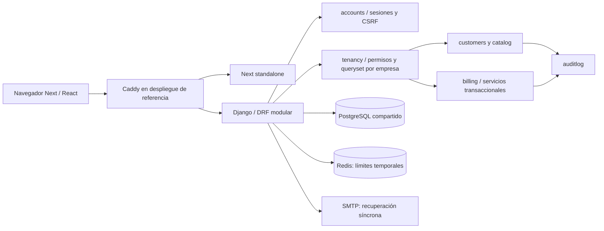

# Fracxion — auditoría empresarial inicial

Fecha: 2026-10-14. Entrega 0: inspección, baseline y diagnóstico. **No se implementaron funcionalidades empresariales ni se crearon migraciones.**

## Dictamen

Fracxion tiene un núcleo funcional de gestión multiempresa, clientes, catálogo, comprobantes internos, cobros reversibles y auditoría transaccional. La suite backend existente pasa sobre PostgreSQL real. La ampliación empresarial debe partir de ese núcleo: no requiere reconstruir la aplicación.

La plataforma todavía no ofrece configuración empresarial completa, administración autónoma de equipos, vencimientos, analítica financiera, exportaciones, automatizaciones, proveedores, gastos ni inventario. Los contadores del resumen consultan datos reales, pero no constituyen un módulo de análisis financiero. Los documentos emitidos son **comprobantes internos sin autorización fiscal de ARCA**.

Hay problemas reproducidos de continuidad de propietarios, cobertura de auditoría administrativa y de autenticación, consultas por línea al emitir, contraste en Clientes y preparación del typecheck en una copia limpia. Ver los hallazgos y el [roadmap propuesto](ENTERPRISE_ROADMAP.md). Las funciones pendientes no deben presentarse como terminadas en el producto, README o portfolio.

## Alcance y preservación

- Repositorio local: `/home/nelson/Proyectos/facturador-saas-api`; remoto `git@github.com:nelsonvis3/fracxion-facturador.git`.
- Baseline: rama `main`, commit `60753dc`; seguimiento local `origin/main`. No se ejecutó fetch/pull, por lo que esto no acredita el estado remoto más reciente.
- Estado inicial: archivos versionados sin diferencias; un archivo preexistente sin seguimiento en `docs/github-profile/README.md`. Se conservó su checksum y no se modificó.
- Se leyeron `AGENTS.md`, instrucciones de frontend, README, documentos de testing/auditoría/operaciones, modelos, servicios, validadores, serializers, vistas, permisos, rutas, componentes, configuración e infraestructura.
- Las pruebas se ejecutaron sobre una copia de los archivos versionados del commit, bajo `/tmp/fracxion-enterprise-audit-20261014/repo`. No se copiaron archivos `.env` privados.
- Cluster PostgreSQL nuevo en ese directorio temporal, puerto `55439`, usuario sintético `audit`. Django creó y destruyó su propia base de tests. E2E utilizó exclusivamente `test_facturador_e2e`.
- Se reutilizó el virtualenv Python existente sin instalar paquetes. Los módulos Node se copiaron físicamente al entorno temporal para no escribir el build en el proyecto original. Esto **no equivale a verificar una instalación desde cero con `npm ci`**.
- Correo controlado en memoria, caché local en tests y cuentas sintéticas. No se contactaron empresas, clientes, bancos ni servicios de pago reales.
- Los comandos de esta entrega se ejecutaron mediante **Bash**, independientemente de que la shell interactiva del equipo sea Fish.

## Versiones y límites del entorno

| Componente | Declarado | Ejecutado en esta auditoría |
| --- | --- | --- |
| Python | Docker/CI: 3.14 | 3.14.7 |
| Django / DRF | 5.2.18 / 3.18.1 | Mismas versiones en virtualenv y requirements |
| Next / React | 16.4.0 / 19.3.0 | Mismas versiones instaladas |
| TypeScript / Tailwind | Rangos en package.json, lockfile existente | 5.9.3 / 4.3.3 |
| Node | Docker/CI: 22 | 24.21.0; npm 11.19.0 |
| PostgreSQL | Compose/CI: 17 | **18.6**, instancia nueva y aislada |
| Redis | Compose: 8 | No ejecutado: no hay servidor Redis ni Docker/Podman disponibles |
| Navegador | Playwright Chromium en CI | Playwright 1.64.0 con Brave/Chromium instalado |
| Accesibilidad | Sin suite Axe propia declarada | Axe 4.14.0 disponible en dependencias locales |

Las pruebas locales no acreditan PostgreSQL 17, Node 22 ni el comportamiento multiworker de Redis 8. La configuración y los workflows se inspeccionaron, pero no se ejecutó GitHub Actions ni un despliegue de producción.

## Arquitectura comprobada

Este diagrama describe la configuración del repositorio; Caddy, Redis y SMTP no se ejecutaron en esta entrega.

| Módulo | Responsabilidad real y evidencia |
| --- | --- |
| `accounts` | Usuario con email normalizado, registro de usuario + empresa + propietario en transacción, login/logout por sesión, CSRF, recuperación con token temporal y limitación de intentos. `registration.py`, `views.py`, `password_reset.py`, `rate_limits.py`. |
| `tenancy` | Empresas y membresías; roles owner/admin/accountant/sales/viewer. `permissions.py` verifica usuario, empresa y membresía activos; `mixins.py` filtra querysets y bloquea filas en actualizaciones. `views.py` no implementa gestión empresarial de equipos. |
| `customers` | Alta, consulta, edición, desactivación/reactivación y validaciones comerciales/geográficas. Mutaciones auditadas y atómicas. |
| `catalog` | Productos/servicios, SKU por empresa, precio, moneda, tasa explícita, unidad y estado activo. No representa existencias. |
| `billing` | Borradores con snapshots; cálculo Decimal y redondeo explícito; emisión única con numeración interna; registro de cobros y reversiones mediante servicios. |
| `auditlog` | Eventos de negocio en la misma transacción que la operación; API de lectura restringida a owner/admin. No cubre todos los eventos de seguridad o administración. |
| `config` | Settings, parsers defensivos, referencias de países/provincias, proxy de confianza, privacidad de respuestas, health/readiness y bootstrap de espacios. |
| Frontend | App Router y componentes por módulo; estado React local, contexto de empresa y `useAsync` con descarte de respuestas tras desmontaje; cliente HTTP central con cookies, errores y CSRF fresco. No hay un motor independiente de cálculos monetarios. |

### Aislamiento y reglas comerciales

Se utilizan tablas compartidas con claves foráneas `tenant` y filtros/permisos en la aplicación. **No hay RLS ni esquemas separados por empresa**: también se comprobó `relrowsecurity=false` en las cinco tablas inspeccionadas. Eso no es, por sí solo, un defecto; las nuevas consultas, tareas y exportaciones deben conservar explícitamente el contexto del tenant.

Los precios/impuestos proceden del catálogo backend, no del navegador; la creación verifica la moneda. Los documentos preservan snapshots del cliente y líneas. La emisión vuelve a comprobar importes, relaciones y estado, bloquea empresa/membresía/documento/líneas y asigna una numeración única por empresa. Notas de crédito/débito existen como opciones del modelo, pero el servicio de emisión las rechaza: **no son flujos implementados**.

Los cobros requieren factura emitida y rol autorizado, impiden sobrepago, mantienen referencias externas únicas por empresa/método cuando se suministran y excluyen reversiones del saldo. Cada reversión exige motivo y se registra una sola vez. La inmutabilidad está protegida por servicios, métodos de modelo, endpoints restringidos y Admin de solo lectura para entidades financieras; no se comprobó una barrera de inmutabilidad mediante triggers contra SQL privilegiado.

### Acoplamiento y calidad

La separación principal es adecuada para un monolito modular. Los serializers validan el contrato y los servicios vuelven a comprobar invariantes dentro de la transacción; esa repetición protege contra cambios concurrentes y llamadas directas al servicio, y no debe eliminarse como una duplicación cosmética.

Las lecturas de facturas anotan cobros y precargan relaciones/líneas; no se detectó un N+1 de saldos en ese listado. Sí se reprodujo el crecimiento de consultas de emisión indicado en F-03. La página de Clientes concentra formulario, validaciones y tabla en un archivo de más de 900 líneas; conviene extraer responsabilidades solo al modificar funcionalidad relevante y con regresión. No se identificó código muerto cuya eliminación esté justificada en esta entrega.

## Centralización y clasificación funcional

“Implementada y probada” se limita al comportamiento que se cita; no significa que se haya cubierto cada combinación posible de permisos o toda la operación en producción.

| Capacidad | Clasificación | Evidencia y límite |
| --- | --- | --- |
| Empresas | Implementada parcialmente | `Tenant`, registro y selector funcionan; falta API/interfaz completa de configuración. |
| Usuarios y acceso | Implementada y probada | Registro, login/logout, recuperación e invalidación por cambio de contraseña en suites accounts y E2E. Faltan verificación de email, MFA y gestión visible de sesiones. |
| Membresías | Implementada parcialmente | Modelo y autorización probados; administración actual en Django Admin, sin invitaciones ni equipo en frontend. F-01/F-02. |
| Clientes | Implementada y probada | Suites customers, rollback de auditoría, aislamiento, edición/reactivación y E2E con persistencia. |
| Productos y servicios | Implementada y probada | Suites catalog, validaciones de precio/tasa/SKU, auditoría y flujo UI. Sin inventario. |
| Facturas internas | Implementada y probada | Borradores, snapshots, impuestos, totales, emisión, inmutabilidad y concurrencia. No hay edición genérica de borradores ni autorización ARCA. |
| Notas de crédito/débito | Ausente como flujo comercial | Opciones de `Invoice.DocumentKind` presentes; emisión explícitamente bloqueada. No se clasifican como funcionales. |
| Pagos y reversiones | Implementada y probada | Suites billing, aislamiento, sobrepagos, rollback, concurrencia y E2E. F-04 delimita idempotencia. |
| Saldos pendientes | Implementada parcialmente | Cálculo real por factura; sin vencimientos, antigüedad, resumen de cartera o recordatorios. |
| Auditoría comercial | Implementada y probada | Altas/cambios/desactivaciones de catálogo/clientes, emisión, cobros y reversiones; lectura por owner/admin. Cobertura de seguridad/administración parcial. |
| Business Settings | Ausente como módulo empresarial | Campos básicos en Tenant/Admin; sin preferencias por empresa, logo, moneda predeterminada, zona horaria o notificaciones. |
| Notificaciones | Ausente | Sin modelo, centro, preferencias ni endpoints. El correo de recuperación es un flujo separado. |
| Reportes y exportaciones | Ausente | Sin servicios analíticos, CSV, XLSX o PDF backend. Imprimir en navegador no constituye un módulo de reportes. |
| Inventario | Ausente | `Product` no contiene libro de movimientos, reservas ni existencias. |
| Gastos/compras | Ausente | Sin modelos, servicios, rutas o UI propios. |
| Proveedores | Ausente | Sin módulo propio ni relación de compras. |
| Backups externos y restauración operativa | Documentada, sin implementación automatizada comprobada | `docs/OPERATIONS.md` propone dump/restore/retención. Una prueba sintética local no acreditaría backup externo ni RPO/RTO de producción. |
| API keys, webhooks y suscripciones | Ausente | No hay endpoints, credenciales, entregas o modelos de planes. Requieren diseño y decisiones posteriores. |

## Automatización y flujos de trabajo

Hoy son automáticos los cálculos de importes, snapshots, numeración al emitir, actualización de saldos derivados y eventos de auditoría vinculados a mutaciones. La solicitud de recuperación envía correo **sincrónicamente** dentro de la petición, con timeout y manejo de errores; las pruebas usan correo en memoria.

No se encontraron workers, scheduler, Celery, Beat, cola de tareas, transactional outbox, historial de ejecución, reintentos empresariales, recordatorios, facturación recurrente, informes programados, aprobaciones o integraciones externas. Emitir, registrar/revertir cobros, administrar membresías, realizar backups y limpiar sesiones vencidas requieren intervención o una programación externa aún no comprobada.

Redis actualmente sirve para límites temporales de autenticación. Compose usa `noeviction` y 128 MB, sin volumen persistente declarado para el servicio. No debe convertirse en única fuente de verdad de trabajos financieros ni compartirse con una cola sin evaluar aislamiento, memoria y persistencia.

## Hallazgos priorizados

P1: resolver antes de exponer la capacidad empresarial correspondiente. P2: mejora necesaria de calidad, fiabilidad o crecimiento. No se identificó un incidente P0 ni se demostró acceso horizontal indebido en los escenarios ejecutados; esto no certifica ausencia de vulnerabilidades.

### F-01 · P1 · Es posible dejar una empresa sin propietario activo

**Evidencia:** `backend/tenancy/admin.py` usa ModelAdmin/inline ordinarios; `Membership` no contiene la invariante. En una empresa sintética con un único owner, un superusuario de prueba hizo POST al formulario de edición de esa membresía con `is_active` desmarcado. Respuesta 302; propietarios activos restantes: **0**.

**Impacto y condición:** un administrador de plataforma autorizado puede dejar a la empresa sin propietario; no se demostró que un usuario común pueda acceder a Admin o escalar privilegios. No hay un procedimiento excepcional explícito que explique o controle ese caso.

**Propuesta:** servicio transaccional de cambios de equipo con bloqueo coherente por empresa, protección de último propietario considerando membresías y usuarios activos, reglas de cambio de rol y un procedimiento administrativo excepcional separado. Aplicar también al Admin y probar dos cambios concurrentes. No modificar datos históricos automáticamente.

### F-02 · P1 · Auditoría empresarial incompleta en cambios administrativos

La misma operación de F-01 creó **1 `django_admin.LogEntry` y 0 `AuditEvent`**. Existe registro de Admin, por tanto no es correcto afirmar que no hay rastro alguno; el historial empresarial y sus permisos no lo incluyen. Revisar también cambios de empresa/usuarios que se efectúan por Admin.

**Propuesta:** invocar servicios explícitos y auditoría transaccional para cambios sensibles; definir qué eventos son de plataforma y cuáles son visibles para la empresa. No duplicar secretos ni cuerpos completos en metadata.

### F-03 · P2 · Consultas por línea durante emisión

`billing/services.py:issue_invoice` ejecuta `Product.objects.filter(...).exists()` dentro del recorrido de líneas. Se midió el servicio con `CaptureQueriesContext`, incluyendo transacción:

| Líneas | Consultas totales | Comprobaciones individuales de producto |
| --- | --- | --- |
| 1 | 13 | 1 |
| 10 | 22 | 10 |
| 100 | 112 | 100 |

**Propuesta:** validar pertenencia del conjunto de productos con consulta agrupada, manteniendo bloqueo, comprobaciones y snapshots. Añadir una prueba de presupuesto de consultas y regresión de mezcla de empresas. Esta medición no es un benchmark de latencia o capacidad concurrente.

### F-04 · P2 · Repetir un cobro sin referencia crea otra operación

En factura sintética de ARS 100, dos llamadas iguales por ARS 10 sin referencia externa crearon **2 pagos** y saldo **ARS 80**. La lógica comercial admite dos pagos distintos; lo que falta es un contrato de idempotencia para distinguirlos de un reintento tras timeout.

**Propuesta:** diseñar clave opcional por empresa/operación, persistida con huella de solicitud y restricción única, respuesta estable y conflicto cuando se reutilice con otro contenido. Preservar la semántica actual cuando no se envíe clave. Es requisito previo para automatizaciones/integraciones con reintentos; no cambiar cálculos ni deduplicar pagos legítimos por similitud.

### F-05 · P1 · Eventos de autenticación fuera de auditoría de seguridad

Login y logout reales mediante vistas Django devolvieron 200/200 sin aumentar `AuditEvent`. Los valores `LOGIN`, `LOGOUT` y `PERMISSION_DENIED` del enum no acreditan implementación. Recuperación tampoco invoca el servicio de auditoría en el código inspeccionado.

**Propuesta:** diseñar eventos mínimos de seguridad, resultados, retención y contexto de plataforma/empresa; no registrar contraseñas, tokens ni correos completos innecesarios. Complementar protección por IP con una política para cuentas privilegiadas y revisar `/admin/login/`, que no utiliza el limitador propio de las vistas API. No se ejecutó un ataque de fuerza bruta sobre producción.

### F-06 · P2 · Typecheck depende de artefactos generados

En copia sin `.next`, `npm run typecheck` falló con `TS2304: Cannot find name 'LayoutProps'` en `src/app/layout.tsx:11`. Después del build, el mismo comando pasó. La documentación local de Next indica que `LayoutProps` se genera con dev/build/typegen.

**Propuesta:** preparar tipos con `next typegen` antes de `tsc --noEmit`, actualizar instrucciones y comprobar ese orden en CI desde checkout limpio. No sustituir tipos válidos para ocultar el problema.

### F-07 · P2 · Cinco paquetes de desarrollo afectados por una alerta transitiva

`npm audit --omit=dev --json`: **0 vulnerabilidades**. Auditoría completa: **5 paquetes con severidad alta**, todos en la cadena `eslint-config-next → @next/eslint-plugin-next → fast-glob → micromatch → braces`; corresponde a un advisory de agotamiento de pila por patrones profundamente anidados, [GHSA-vfj7-8cjw-p6xm](https://github.com/advisories/GHSA-vfj7-8cjw-p6xm).

Esto afecta al tooling y no prueba explotación del runtime público. npm propone un downgrade incompatible de eslint-config-next a 14.2.35; no se aplicó. Revisar una resolución compatible, su alcance real en CI y regresiones antes de cambiar lockfile. `pip-audit -r requirements.txt` no reportó vulnerabilidades conocidas en las dependencias Python resueltas durante esta ejecución.

### F-08 · P2 · Contraste insuficiente en Clientes

Axe detectó `color-contrast` en textos `.text-slate-400` de tabla y pie en `frontend/src/app/dashboard/[tenantId]/customers/page.tsx` (por ejemplo líneas 554, 570 y 692). Relaciones observadas: **2,63:1 sobre blanco y 2,51:1 sobre slate-50**, menores que 4,5:1 para ese texto pequeño. No basta el contraste del dashboard para concluir que todos los módulos son accesibles.

**Propuesta:** ajustar el color de esos textos conservando el sistema visual y verificar tabla/pie, estados vacíos y formularios con datos reales de prueba. El informe Axe es una comprobación parcial, no certificación WCAG.

### F-09 · P2 · El modal no devuelve el foco al disparador

El modal de producto se abre con Enter, recibe foco y cierra con Escape. Una revisión dirigida confirmó que al cerrar con **Escape, Cancelar y el botón de cierre**, `activeElement` queda en BODY en lugar del botón “Nuevo producto”, incluso después de dos frames. Se probó también foco programático sobre el disparador con el modal abierto: el fondo permaneció inerte. Los saltos a BODY durante Tab no demostraron acceso a controles del fondo y no se presentan como fallo de aislamiento del modal.

**Propuesta:** restaurar explícitamente el foco al elemento que abrió el modal, conservando `showModal`, y probar Tab/Shift+Tab/Escape y las tres formas de cierre. No se considera resuelto por el solo uso de `<dialog>` ni por ausencia de alertas Axe. Evidencia: `focus-observations.json`.

## Escalabilidad, personalización y operaciones

- Los listados de negocio están paginados a 25 registros; filtros/búsqueda están implementados. `my_tenants` devuelve una lista sin paginación. No se midió un volumen que justifique cambiar ese contrato ahora.
- Hay índices por empresa/estado/fechas, SKU/documento únicos por empresa, números internos únicos y referencias de cobro únicas cuando existen. Los reportes futuros exigirán consultas y planes reales antes de agregar índices por moneda, emisión o vencimiento.
- Los servicios financieros bloquean la fila de Tenant. Eso protege numeración y saldos, pero serializa operaciones financieras distintas de una misma empresa. Las pruebas verifican integridad concurrente, **no throughput máximo**. No retirar el bloqueo sin nuevo diseño y medición.
- `CONN_MAX_AGE=60`, comprobación de conexiones y Gunicorn con tres workers; no se encontró PgBouncer, pooling configurado ni prueba de capacidad/memoria sostenida. No hacen falta para declarar el núcleo funcional; sí requieren presupuesto operativo antes de crecer.
- El resumen hace cuatro llamadas paginadas para obtener cantidades, descargando también registros; el listado de facturas precarga líneas. Un servicio agregado futuro debe evitar ese costo y separar métricas por moneda.
- Zona horaria backend y formateo frontend fijados a Argentina. La entrada datetime-local de cobros usa zona del dispositivo. Debe definirse la zona por empresa antes de informes y programación; no reasignar fechas históricas.
- Imágenes base etiquetadas por major, dependencias directas Python fijadas pero transitivas sin lock reproducible/hash. Revisar fijación y actualización controlada de imágenes/transitivas; no instalar otro gestor por defecto.
- PostgreSQL y Caddy tienen volúmenes; no hay almacenamiento empresarial seguro para logos/adjuntos implementado. Los nuevos archivos necesitan validación, permisos, límites y una política de retención.
- Existen health y readiness, reinicios Compose y rechazo de migraciones pendientes al iniciar. Logs de aplicación son de consola, sin estructura JSON/correlación sistemática; el campo de auditoría `request_id` no tiene middleware generador encontrado.
- Backups externos, alertas, restauración de infraestructura, rollback real y monitoreo de recursos no están acreditados por estas pruebas locales. `clearsessions` figura como operación a programar, no como job implementado.

## Seguridad y trazabilidad: alcance de la verificación

Se utilizó [OWASP ASVS 5.0.0](https://owasp.org/projects/asvs) como referencia temática, sin afirmar conformidad completa ni certificación externa.

| Área | Resultado/evidencia | Pendiente |
| --- | --- | --- |
| IDOR y tenant | Suites de tenants/clientes/catálogo/facturas/pagos/auditoría y matriz suplementaria: rechazo de empresa ajena e IDs mezclados. | Extender misma matriz a cada nuevo endpoint/tarea/exportación; no hay RLS de respaldo. |
| Escalada vertical | Roles backend; registro rechaza roles/staff/superuser enviados; owner no equivale a staff de plataforma. | Equipo, invitaciones y último propietario; MFA para privilegiados. |
| Sesión/CSRF/CORS | Cookies HttpOnly, token enmascarado JSON y rotación, rechazo de mutaciones sin CSRF y origen ajeno; no-store en API. | Validación runtime de Secure/HTTPS detrás del proxy final en esta nueva entrega. |
| Recuperación | Respuesta genérica, expiración, un solo uso, invalidación de sesiones y correo de tests. | Entregabilidad SMTP, verificación de email y eventos de seguridad. |
| Entradas | Límites de cuerpo/profundidad/credenciales, Unicode/NUL, números no finitos, relaciones y overflow; tests existentes pasan. | Revisión continua de nuevas entradas y adjuntos. |
| Dependencias | Python sin alertas conocidas; producción Node sin alertas; tooling Node con F-07. | Resolver cadena compatible sin downgrade forzado; verificar imágenes de contenedor. |
| Auditoría | Mutaciones comerciales y rollback probado; API de solo lectura sin IP/user-agent expuestos. | F-02/F-05, correlación, retención e integridad frente a administradores de DB. |
| Headers y secretos | Configuración de HTTPS/HSTS/hosts/proxy/cookies y `check --deploy` con entorno sintético; `.env` privados ignorados y solo ejemplos versionados. | CSP compatible con Next/animaciones; revisión de secretos en historial completo no ejecutada. |
| Archivos/exportaciones | No hay módulo empresarial implementado, por tanto no se acredita seguridad de futuras descargas. | Acceso por tenant, expirar enlaces, tipos/tamaños, fórmula CSV/XLSX y SSRF en integraciones. |

No se confundió la importación válida de settings de producción con una prueba de SMTP, Redis o HTTPS reales. Los límites se probaron con caché de tests; queda pendiente su comportamiento distribuido ante caídas de Redis.

## Pruebas y evidencia

Los registros reproducibles se conservan en [enterprise-evidence/2026-10-14](enterprise-evidence/2026-10-14/README.md). Cada comprobación tiene comando, cwd aislado, código de salida y duración; los fallos de red/sandbox se diferencian de fallos del producto. Las duraciones pertenecen a esta máquina y no son métricas de rendimiento empresarial.

| Comprobación | Comando ejecutado dentro del área indicada | Resultado real |
| --- | --- | --- |
| Backend lint | `.venv/bin/ruff check .` | Aprobado. |
| Backend formato | `.venv/bin/ruff format --check .` | Aprobado, 81 archivos. |
| Django | `.venv/bin/python manage.py check` | Aprobado, 0 incidencias. |
| Migraciones | `.venv/bin/python manage.py makemigrations --check --dry-run` | Aprobado, sin cambios pendientes del modelo. No crea migraciones empresariales. |
| Migraciones aplicadas | `env DJANGO_SETTINGS_MODULE=config.e2e_settings .venv/bin/python manage.py migrate --check` | Aprobado sobre la base sintética E2E después del seed. No prueba el estado de ninguna base comercial. |
| OpenAPI | `.venv/bin/python manage.py spectacular --validate --fail-on-warn --file /tmp/fracxion-enterprise-audit-20261014/evidence/openapi.yaml` | Aprobado. |
| Suite Django | `.venv/bin/coverage run manage.py test --settings=config.test_settings --noinput` | **216/216**, 12,124 s de suite; PostgreSQL 18.6 real. Incluye concurrencia de registro, emisión, sobrepagos y referencias duplicadas. |
| Cobertura | `.venv/bin/coverage report --fail-under=85` | **91 % redondeado**: 2007 statements, 190 sin ejecutar; 90,53 % antes del redondeo. Cobertura de sentencias, no de ramas. |
| Dependencias Python | `.venv/bin/pip-audit -r requirements.txt --format json --progress-spinner off --timeout 20` | Aprobado: 0 vulnerabilidades conocidas reportadas. No se auditó requirements-dev como conjunto separado. |
| Frontend lint | `npm run lint` | Aprobado. |
| TypeScript limpio | `npm run typecheck` | **Falló** por falta de `LayoutProps` generado, F-06. |
| Build estándar | `npm run build` | **Bloqueado por entorno**, EPERM al abrir puerto en Turbopack; persistió fuera del sandbox inicial. No se declara aprobado. |
| Build alternativo documentado | `npm run build -- --webpack` | Aprobado, 39,31 s, incluye TypeScript y preparación standalone/assets. |
| TypeScript posterior | `npm run typecheck` | Aprobado después del build; no invalida F-06. |
| Dependencias Node producción | `npm audit --omit=dev --json` | Aprobado: 0 vulnerabilidades. |
| Dependencias Node todas | `npm audit --json` | **Falló por hallazgos**: 5 paquetes altos en una cadena de desarrollo, F-07. |
| Playwright, primer intento | `npm run test:e2e` | 33/35; dos fallos de login por límite compartido con las sondas adicionales de esta auditoría. Error de aislamiento de la ejecución, no fallo demostrado de las transiciones. |
| Playwright, servidor limpio y sin sondas concurrentes | `npm run test:e2e` | **35/35**, 260,06 s del proceso; misma aplicación y mismos límites, tras reiniciar API de tests y regenerar fixture. |
| Roles/tenant suplementarios | `env DJANGO_SETTINGS_MODULE=config.e2e_settings .venv/bin/python enterprise_roles.py` | **80/80** comprobaciones HTTP con APIClient, cinco roles, estados inactivos, acceso ajeno e IDs mezclados. No son 80 nuevos tests permanentes ni E2E. |
| Reproducciones de hallazgos | `env DJANGO_SETTINGS_MODULE=config.e2e_settings .venv/bin/python enterprise_probes.py` | Completadas: F-01/F-02/F-03/F-04/F-05. La ejecución exitosa de una sonda confirma el hallazgo, no su corrección. |
| Responsive/Axe | `node enterprise-browser.mjs` | 21 comprobaciones a 1440/768/390 px, 0 desbordamientos de página, 0 pageerrors y 0 respuestas 5xx. Ocho inspecciones Axe: 7 sin violaciones y Clientes con `color-contrast`. |
| Foco dirigido | `node enterprise-focus.mjs` | Hallazgo F-09 confirmado en tres formas de cierre; controles del fondo permanecen inertes. |
| Settings de producción | `.venv/bin/python manage.py check --deploy --fail-level WARNING` con entorno sintético de producción | Aprobado. No verifica disponibilidad real de SMTP/Redis/HTTPS. |
| Dump y restore sintéticos | `.venv/bin/python /tmp/fracxion-enterprise-audit-20261014/restore_probe.py` | Aprobado: dump, base nueva y restore; **10 tablas / 324 registros** con conteos y SHA-256 del contenido idénticos. PostgreSQL 18.6 local; no acredita backups externos/RPO/RTO. |

Las sondas suplementarias y su configuración se conservan con la evidencia. Su ejecución requiere reconstruir un entorno aislado equivalente y nunca apuntarlas a una base comercial. La primera matriz de roles esperaba incorrectamente 403 para anónimos y produjo cinco discrepancias; se corrigió la expectativa a **401 según `accounts/authentication.py`**, sin modificar el producto, y se repitió con una nueva empresa sintética. No eran cinco accesos indebidos.

Los primeros intentos de npm/pip-audit fallaron por red restringida; se repitieron con acceso y los resultados efectivos son los de arriba. El primer build también rechazó el symlink de dependencias fuera del árbol temporal; se corrigió la copia de pruebas, sin modificar código. Se conservan estos antecedentes para no atribuir errores del montaje al producto.

### Cobertura funcional de los 17 flujos solicitados

| Flujos | Evidencia actual |
| --- | --- |
| 1–4: registro/empresa, login/logout, recuperación, selección | `accounts/test_registration.py`, `accounts/tests.py`, `frontend/e2e/business.spec.ts`, dashboard/session-transition. Cambio de contraseña, token de un uso y nueva sesión reales sobre datos sintéticos. |
| 5: permisos de roles | Permisos/servicios y suites existentes, más matriz 80/80 con los cinco roles. No es una enumeración exhaustiva de cada endpoint × estado × acción. |
| 6–7: clientes y catálogo | Suites customers/catalog y recorrido E2E con persistencia después de recargar. Incluye edición/desactivación/reactivación de clientes. |
| 8–10: borrador, emisión y totales | Servicios billing y E2E: ARS 100 + tasa explícita 21 % = ARS 121. Los importes se calculan en Django. |
| 11–14: pagos parciales/totales, reversión y saldos | `PaymentServiceTests`, `PaymentAPITests`, regresiones/concurrencia y E2E parcial/reversión. El pago total se verifica en backend; no se afirma un recorrido UI de pago total independiente. |
| 15: historial | Suites auditlog y E2E de cobro/reversión; F-02/F-05 delimitan eventos no cubiertos. |
| 16–17: bloqueo y ausencia de filtraciones en escenarios | Suites multiempresa, E2E security y matriz con IDs externos. No se afirma ausencia universal de filtraciones fuera de esos escenarios. |

### Interfaz y límites restantes

La suite cubre navegación, formularios de registro/clientes/productos/borrador/cobro/reversión, errores/validaciones, vacío y reintento, expiración de sesión, teclado de introducción, historial tras logout y preferencias de movimiento reducido. El dashboard se comprobó además a 320 px, contraste en temas claro/oscuro y contadores contra API. Algunas pruebas de estados de error/carga usan interceptación deliberada de red; los flujos comerciales citados sí persisten contra Django/PostgreSQL.

Se revisaron capturas reales de facturas en desktop y mobile; la tabla móvil utiliza desplazamiento interno, sin ensanchar el documento. No se afirma revisión manual exhaustiva con lector de pantalla, todos los campos y tamaños posibles o todos los estados de contraste. F-08/F-09 permanecen abiertos.

**No ejecutado o pendiente:** stack Docker/Compose con PostgreSQL 17 + Redis 8 + Caddy; Node 22; arranque/caída de Redis y límites compartidos entre workers; SMTP real; restauración desde backup externo; medición de carga/memoria/latencia; auditoría de imágenes/historial completo de secretos; revisión ASVS requisito por requisito; aceptación con usuarios reales. El impedimento de contenedores es la ausencia de Docker/Podman en el equipo, no un error del proyecto.

## Cierre de Entrega 0

- **Verificado:** núcleo comercial, pruebas detalladas y reproducciones anteriores; informes redactados sobre código y ejecución actual.
- **Implementado:** únicamente documentación y evidencia de auditoría. No se añadió funcionalidad empresarial.
- **Implementado pero no probado:** ninguna funcionalidad nueva; configuración de infraestructura existente inspeccionada, pendiente de ejecución del stack objetivo.
- **Archivos añadidos:** `docs/ENTERPRISE_AUDIT.md`, `docs/ENTERPRISE_ROADMAP.md` y evidencia bajo `docs/enterprise-evidence/2026-10-14/`. Archivo previo `docs/github-profile/README.md` conservado.
- **Migraciones/dependencias añadidas:** ninguna. Las migraciones existentes solo se aplicaron a bases sintéticas nuevas.
- **Fallos pendientes del producto/calidad:** F-01 a F-09; los hallazgos de tooling, contraste y preparación del typecheck siguen abiertos, aunque backend/build alternativo/E2E limpio pasan.
- **Bloqueado por entorno:** Turbopack y verificación del stack de contenedores objetivo. Compatibilidad de Celery con Python 3.14 no acreditada.
- **Impacto:** código de producto y contratos API intactos; ninguna base comercial modificada. No se publicó, desplegó ni actualizó el portfolio.
- **Preservación/limpieza:** HEAD y archivos versionados originales sin cambios; checksum del README previo conservado. Puertos temporales 8001/3010/55439 libres, servidores y cluster detenidos. Eliminadas únicamente las copias temporales de node_modules, `.next`, `.ruff_cache` y tsbuildinfo; conservadas evidencias y bases sintéticas detenidas. Ver `integrity.json` y `stopped-listeners.json` en la evidencia.
- **Próximo trabajo recomendado:** aprobar 0.1 y Entrega 1 conforme al roadmap, antes de implementar o crear migraciones empresariales.

## Fuentes técnicas para las siguientes entregas

- [Next: typegen](https://nextjs.org/docs/app/api-reference/cli/next#next-typegen-options); contrastado además con documentación local de Next 16.4.0.
- [Celery 5.6: versiones soportadas](https://docs.celeryq.dev/en/stable/history/whatsnew-5.6.html) y [paquete estable](https://pypi.org/project/celery/). La versión estable consultada es 5.6.3; sus declaraciones de soporte enumeran Python hasta 3.13, **no acreditan Python 3.14**. No se instaló Celery ni se recomienda adoptar una prerelease por defecto.
- [Celery y Django: ejecución después de commit](https://docs.celeryq.dev/en/stable/django/first-steps-with-django.html#trigger-tasks-at-the-end-of-the-database-transaction). Es una recomendación de diseño futuro, no una integración presente.
- [Django: lista de despliegue](https://docs.djangoproject.com/en/5.2/howto/deployment/checklist/) y documentación operativa del repositorio.

La implementación queda pendiente de aprobación del roadmap, como exige el punto de control solicitado y `AGENTS.md`.
