# Introducción y transiciones de sesión de Fracxion

La pantalla `/` incorpora una composición Hyperframes: aparece la F en el centro,
se despliega `racxion`, las letras vuelven hacia la F, el logo se desplaza hasta su
posición en el login y una transición revela el formulario existente. Su icono usa
ahora la misma F; se conservan los textos, campos y lógica de autenticación.

Capturas reales: [introducción en escritorio](screenshots/login-intro-desktop.png),
[introducción móvil](screenshots/login-intro-mobile.png),
[login en escritorio](screenshots/login-after-intro-desktop.png) y
[login móvil](screenshots/login-after-intro-mobile.png).
Esta revisión añade capturas del [despliegue sin superposición](screenshots/login-intro-emergence-desktop.png),
la [bienvenida](screenshots/session-welcome-desktop.png) y la
[despedida móvil](screenshots/session-farewell-mobile.png).
La continuidad se ve en la [F durante la carga en escritorio](screenshots/session-loading-desktop.png),
su [versión móvil](screenshots/session-loading-mobile.png), el
[fundido hacia el dashboard](screenshots/session-dashboard-fade.png) y la
[introducción después del logout](screenshots/session-logout-intro.png).
La corrección del viewport tiene capturas de [la primera carga sin scrollbar](screenshots/login-intro-no-scroll-desktop.png),
[la introducción móvil](screenshots/login-intro-no-scroll-mobile.png) y
[el login con scroll habilitado](screenshots/login-scroll-restored.png).

## Secuencia

| Tiempo | Acción |
| --- | --- |
| 0–0,6 s | F visible desde la carga, sin desaparecer al iniciar Hyperframes. |
| 0,65–1,7 s | Despliegue del nombre. |
| 1,7–2,05 s | Pausa con Fracxion completo. |
| 2,05–2,8 s | Retracción de las letras. |
| 2,85–3,9 s | Desplazamiento y reducción hasta el logo del login. |
| 3,45–4,8 s | Transición del fondo y entrega al formulario. |

La introducción se reproduce al cargar o refrescar el login. Una navegación interna
en el mismo documento no la repite después de completarla. El dashboard no ejecuta
la introducción ni la bienvenida al refrescar. No se usa `sessionStorage` para
recordar la introducción; la clave de la versión anterior dejó de utilizarse.

El defecto del despliegue consistía en mover cada letra con una distancia y un
retardo distintos mientras otra máscara revelaba el texto: los caracteres se
superponían en cuadros intermedios. Ahora el texto mantiene su espaciado natural y
una única máscara revela el prefijo `r → ra → rac → racxion`. La retracción usa la
misma máscara. La F mantiene la apariencia de su placeholder al iniciar el player.

## Scroll y cobertura de la ventana

Mientras la introducción está pendiente, cargando o reproduciéndose, el documento
oculta su scroll y no reserva espacio para la barra. La regla CSS se aplica al
HTML inicial, antes de la hidratación, y deja de aplicarse al completar la secuencia.
El formulario conserva su altura natural: el scrollbar aparece entonces si el
contenido excede la ventana. Omitir, Escape, resize, error y timeout también
liberan el scroll. Movimiento reducido y el fallback sin JavaScript permiten
desplazar el login directamente.

La captura enviada se reprodujo con un scrollbar nativo de 15 px: la composición
medía 1440×600, pero su contenedor tenía 1425 px de ancho. Hyperframes ajustaba el
iframe a 1425×593,75 y lo centraba con 3,125 px de espacio arriba y abajo, dejando
visible el fondo blanco. Al eliminar el gutter durante la secuencia, el iframe
ocupa exactamente el viewport, sin forzar ni deformar la composición.

La limpieza del componente marca como completa una introducción suspendida por
React Activity, para que una ruta inactiva conservada en el DOM no bloquee el
scroll de las otras pantallas. El fondo animado sigue revelando el login durante
su transición final.

## Bienvenida y despedida

Después de un login válido aparece **Bienvenido/a** con el nombre y apellido
devueltos por Django. Si faltan, se utiliza el nombre de una empresa accesible
desde la API de membresías; sin empresa disponible, el texto es genérico. El alta
pública también muestra la bienvenida antes de entrar a la empresa recién creada.
Se vacían los campos de credenciales antes de mostrar el saludo. Los errores de
autenticación conservan el formulario y no muestran una bienvenida.

Después de confirmar el POST de logout, aparece **Hasta pronto**: con el nombre del
usuario desde el selector, o con la empresa activa desde su espacio de trabajo.
Las vistas privadas se desmontan durante la despedida y no vuelven a montarse
antes de la navegación completa al login. Un logout rechazado conserva la sesión
y permite reintentar, sin afirmar que se cerró.

Los saludos duran aproximadamente 2,1 segundos, admiten **Continuar** y
Escape, mantienen el foco dentro del diálogo y respetan movimiento reducido.
El texto se desvanece mientras la F gira una vuelta y se desplaza al centro.
Al ingresar, la F continúa girando sobre el mismo fondo mientras el dashboard
consulta la sesión y las empresas. La pantalla se revela con un fundido de 650 ms
cuando sus datos o su estado de error están listos; el botón de reintento queda
disponible si la consulta falla. Una espera máxima de 12 segundos libera la
presentación si el destino no notifica su estado. La omisión adelanta el saludo,
pero conserva esta espera de datos. Un
fallo o demora del recurso visual no impide completar la navegación. Los nombres
se renderizan como texto de React: no se interpolan en HTML, `srcdoc`, storage ni
URLs. No se agregaron dependencias.

El logout sigue descartando el documento completo para limpiar los datos retenidos
por React Activity. La despedida termina con la F centrada, sin rotación residual,
con el mismo tamaño y fondo que la introducción. El nuevo documento reproduce
**F → racxion → F → logo → login** antes de entregar el formulario. Ya no se agrega
`#salida` al destino; una URL con ese fragmento de una versión anterior lo elimina
sin omitir la introducción. El siguiente refresh también vuelve a reproducirla.

```mermaid
flowchart LR
  A[Login] --> B[Django confirma sesión]
  B --> C[Vaciar credenciales]
  C --> D[Bienvenida]
  D --> J[F girando mientras carga]
  J --> K[Datos o error disponibles]
  K --> E[Fundido hacia dashboard]
  E --> F[Django confirma logout]
  F --> G[Desmontar vistas privadas]
  G --> H[Despedida]
  H --> I[Documento nuevo e introducción completa]
```



**Omitir introducción** y Escape entregan inmediatamente el login. Mientras se
reproduce, el formulario queda fuera de la navegación por teclado y lector de
pantalla. El botón de omisión pasa el foco al correo. Movimiento reducido evita la
animación. Un resize, un error de carga o el límite de 9 segundos también liberan el
formulario. Sin JavaScript se oculta la introducción; esto no agrega autenticación
sin JavaScript al formulario existente.

## Archivos y dependencias

- `frontend/src/components/login-intro.tsx`: carga, reproducción, omisión y limpieza.
- `frontend/src/components/brand-mark.tsx`: F vectorial del login.
- `frontend/public/hyperframes/fracxion-intro/index.html`: composición HTML y
  timeline GSAP registrado en `window.__timelines["fracxion-intro"]`.
- `frontend/scripts/prepare-hyperframes.mjs`: genera los scripts locales antes de
  dev/build. Se incluyen en standalone y en el build Docker.
- `frontend/e2e/login-intro.spec.ts`: ocho escenarios de regresión de la introducción.
- `frontend/e2e/login-viewport.spec.ts`: cinco escenarios con scrollbars nativos
  visibles, carga antes de hidratar, escritorio/móvil, restauración y fallback
  sin JavaScript.
- `frontend/src/components/session-transition.tsx`: presentaciones compartidas en
  el layout raíz, con GSAP, foco, limpieza y protección de las vistas privadas.
- `frontend/src/lib/api.ts`: callback después del logout exitoso y redirección
  obligatoria en `finally`; se conservan cookies, CSRF y tratamiento de errores.
- `frontend/e2e/session-transition.spec.ts`: siete escenarios de saludos, privacidad,
  nombre de empresa, accesos rechazados, movimiento reducido, carga lenta y
  entrega del estado de error del destino.
- `backend/scripts/seed_e2e.py`: cuenta sintética adicional sin nombre y con rol
  viewer para verificar el fallback de empresa. No se cambia el backend comercial.

Paquetes oficiales del [repositorio Hyperframes](https://github.com/heygen-com/hyperframes):
`@hyperframes/player@0.8.155`, `@hyperframes/core@0.8.155` y `gsap@3.15.0`, fijados
en el lockfile. No se instaló Studio ni el CLI de render. El player se importa solo
cuando necesita mostrar la introducción.

Hyperframes controla la entrada completa. Se desactiva la animación CSS de entrada
de los textos dentro de este login, para que el logo móvil no siga desplazándose
cuando se calcula el destino de la F. El layout final se mantiene.

Se carga HTML estático propio como `srcdoc`, sin interpolar datos empresariales ni
credenciales. `runtime-src` y el script de la composición usan la misma URL local
absoluta para impedir la inyección automática del CDN. Se conserva
`X-Frame-Options: DENY` en la app. El iframe utiliza el modo de confianza del player;
no debe usarse para aislar HTML externo o proporcionado por usuarios.

`public/hyperframes/vendor/` está excluido de Git y ESLint: son copias generadas de
terceros sin modificar. Los componentes y scripts propios siguen pasando por lint.

## Verificación local

Python 3.14.7, Django 5.2.18, DRF 3.18.1, Node 26.11.1, Next 16.4.0, React 19.3.0,
Playwright 1.64.0 y Brave/Chromium headless. PostgreSQL 18.6 temporal en
`127.0.0.1:55439` con bases independientes. PostgreSQL 17 de Compose no se ejecutó;
la máquina no dispone de Docker.

| Comprobación | Resultado |
| --- | --- |
| ESLint y TypeScript | Aprobados. |
| Build `npm run build -- --webpack` | Aprobado, con assets locales y standalone. |
| Scrollbars nativos y bordes | Antes: viewport 1440 px, contenedor 1425 px, franjas de 3,125 px. Después: iframe y viewport coinciden, scroll bloqueado durante la intro y operativo en el login. Verificado a 1440×600 y 390×600, incluso antes de ejecutar JavaScript. |
| Backend y concurrencia PostgreSQL, revisión anterior | 216 tests aprobados. No se repitieron en esta corrección de CSS/ciclo de vida; Django no cambió. |
| Coverage, revisión anterior | 91%: 2.007 sentencias, 190 sin ejecutar; umbral 85% aprobado. |
| E2E completo de esta revisión | 35/35 aprobados en una ejecución conjunta de 4,8 minutos, sin reintentos ni pruebas omitidas. |
| Reproducción de transiciones, revisión anterior | 1440×900 y 390×844: introducción, bienvenida, F girando, fundido, despedida e introducción posterior al logout. Giro y posición central comprobados; tamaño/posición de la F antes y después del cambio de documento coinciden con menos de 1 px de diferencia. Cero excepciones JavaScript, respuestas 5xx y solicitudes externas. Sesión revocada y DOM privado retirado durante la despedida. |
| Grabaciones de transiciones, revisión anterior | Dos WebM del flujo completo decodificadas íntegramente con FFmpeg; capturas y secuencias de cuadros inspeccionadas en ambas resoluciones. |
| `npm audit --omit=dev`, revisión anterior | 0 vulnerabilidades conocidas reportadas. |
| `npm audit` completo, revisión anterior | 5 avisos altos de desarrollo en la cadena ESLint/`braces` ya documentada en `AUDIT.md`; sin `audit fix --force`. |
| Linter Hyperframes, composición sin cambios | 0 errores; 2 sugerencias para separar escenas anidadas en subcomposiciones de Studio. Se conserva esta composición breve con dos pistas. |

El build verificado utiliza Webpack. En la entrega inicial, Turbopack no pudo abrir
su puerto interno en este entorno. PostgreSQL 17 de Compose sigue sin ejecutarse.

Para reproducir, preparar base/API según `TESTING.md`, compilar con
`NEXT_PUBLIC_API_BASE_URL=http://127.0.0.1:8001`, iniciar standalone en 3010 y ejecutar
`npm run test:e2e`. `PLAYWRIGHT_CHROMIUM_EXECUTABLE_PATH` permite usar un navegador
existente; aquí se utilizó `/opt/brave-bin/brave`. Se utilizó la configuración
del repositorio:

```bash
PLAYWRIGHT_CHROMIUM_EXECUTABLE_PATH=/opt/brave-bin/brave npm run test:e2e -- --output=/tmp/fracxion-intro-viewport/final-results
```

Esta corrección lleva la suite de 30 a 35 escenarios. Se conservan las regresiones
de privacidad, autenticación y operaciones comerciales. Los resultados actuales
están en `/tmp/fracxion-intro-viewport/`: `target-e2e.log`, `final-e2e.log`,
`lint.log`, `typecheck.log`, `build-e2e.log` y la medición `before.json`.
Los cinco tests específicos pasaron en su primer intento y la suite completa aprobó sin fallos ni omisiones. Las capturas comprueban
la carga con JavaScript pendiente, la reproducción y el login desplazable.

Se detuvieron la API, el frontend y PostgreSQL temporales tras completar las pruebas.
El build se repitió correctamente con el entorno habitual, sin la URL de la API
E2E. El resultado standalone incluye los assets Hyperframes; el log está en
`build-default-env.log` dentro del mismo directorio temporal.

Las pruebas y grabaciones de las transiciones anteriores se conservan por separado
en `/tmp/fracxion-smooth-session/`; los cinco avisos de npm de desarrollo continúan
documentados y no se modificaron dependencias en esta corrección.

No se modificaron modelos, migraciones, cálculos financieros ni bases reales. No se
publicó ni desplegó el cambio. La auditoría empresarial y el portfolio son trabajo
posterior; esta entrega cubre la introducción del login y las transiciones de sesión.
